## From robot data to robot behavior {#recap data-chapter="1" data-seconds="19" }

W06 · Action as a New Modality

[What experience do robots learn from?]{.statement}

Today: **How does experience change their actions?**


## The semester in one picture {#semester data-chapter="1" data-seconds="10" }




## How this course runs {#course-rules data-chapter="1" data-seconds="7" }

- Attendance: every session
- Assignments and deadlines: the LMS
- Questions: Wooclap throughout the lecture

::: {.footnote}

:::


## Ask anytime {#ask data-chapter="1" data-seconds="10" .qr-slide}



Questions now. Answers shared after the lecture.


## Making coffee {#coffee-drop data-chapter="1" data-seconds="28" }




## Today’s route {#today-roadmap data-chapter="1" data-seconds="23" .roadmap-slide}

```{=html}
<div class="lecture-roadmap" aria-label="Today’s lecture roadmap">
<div class="roadmap-step current" aria-current="step"><span class="roadmap-number">01</span><span>Robot tasks</span></div>
<div class="roadmap-step upcoming"><span class="roadmap-number">02</span><span>Learning signals</span></div>
<div class="roadmap-step upcoming"><span class="roadmap-number">03</span><span>Action sequences</span></div>
<div class="roadmap-step upcoming"><span class="roadmap-number">04</span><span>Requests + actions</span></div>
<div class="roadmap-step upcoming"><span class="roadmap-number">05</span><span>Predicted outcomes</span></div>
<div class="roadmap-step upcoming"><span class="roadmap-number">06</span><span>Plans + execution</span></div>
</div>
```

::: {.roadmap-question}
From a robot’s task to the decisions behind its actions.
:::


## Three action domains {#task-families data-chapter="1" data-seconds="45" }

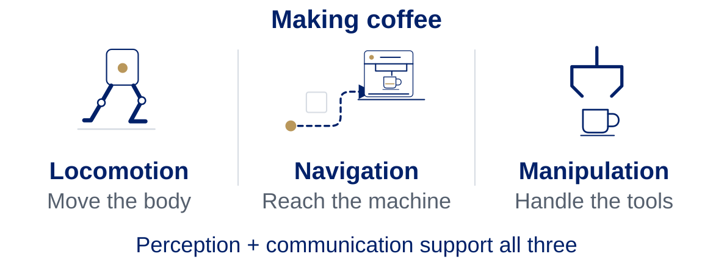{width="100%"}


## Several abilities in one robot {#combined data-chapter="1" data-seconds="16" }




## Observe, choose, act {#feedback data-chapter="1" data-seconds="50" }

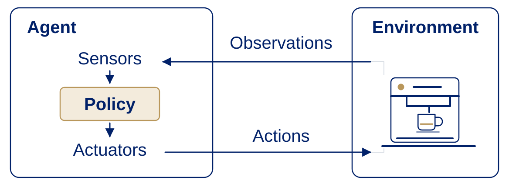{width="100%"}


::: {.footnote}
Teaching adaptation of [UC Berkeley CS188, 2026](https://inst.eecs.berkeley.edu/~cs188/sp26/assets/lectures/cs188-sp26-lec01.pdf#page=45)
:::

Policy: a rule or model for choosing actions.


## Feedback and learning {#policy-learning data-chapter="1" data-seconds="32" }

**During execution**

New observation → Next action

**During learning**

Experience → Updated policy


## Why manipulation, and why now? {#manipulation-focus data-chapter="1" data-seconds="45"}

**Precise actions, sustained over many steps**

Long-horizon tasks require adaptation and recovery.

**Robot foundation models are accelerating progress.**

Generalization and reliability remain open challenges.

::: {.footnote}
[Earlier long-horizon manipulation (2021)](https://proceedings.mlr.press/v155/pirk21a.html) · [π0.5 (2025)](https://arxiv.org/abs/2504.16054) · [π*0.6 (2025)](https://arxiv.org/abs/2511.14759)
:::


## From one task to reusable skills {#reusable-skills data-chapter="1" data-seconds="37" }

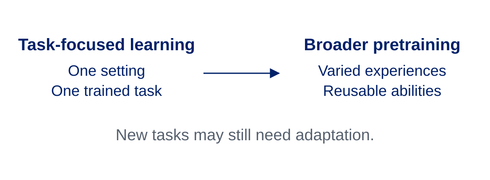{width="100%"}

::: {.footnote}
[Hu et al., 2024](https://arxiv.org/html/2312.08782v3) · [Bai et al., 2026](https://arxiv.org/html/2512.22983v2) · Teaching synthesis
:::


## Three directions we will connect {#research-directions data-chapter="1" data-seconds="45" }

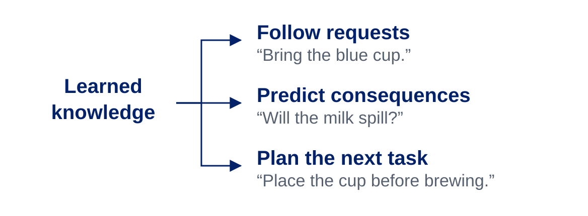{width="100%"}

**These directions can work together in one robot.**

::: {.footnote}
Selected, compatible directions · Teaching synthesis of [Bai et al., 2026](https://arxiv.org/html/2512.22983v2) and [Hou et al., 2026](https://arxiv.org/html/2605.00080v1)
:::


## How does experience improve a policy? {#learning-bridge data-chapter="1" data-seconds="28" }

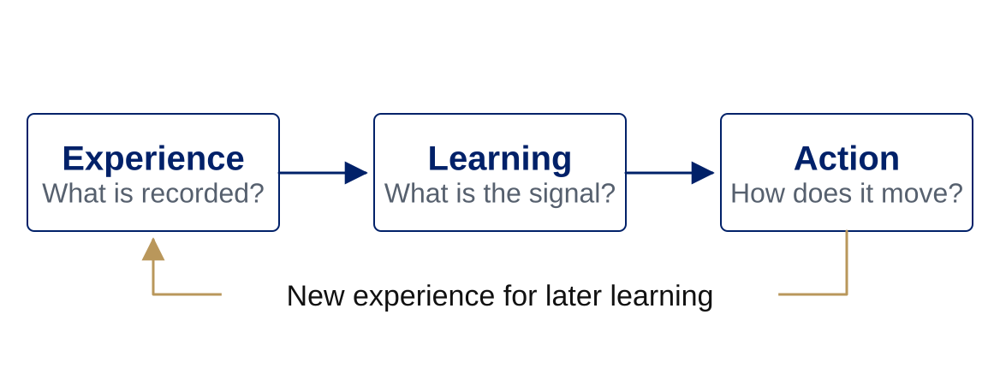{width="100%"}


## 02 · Learning signals {#signals data-chapter="2" data-seconds="19" .roadmap-slide}

```{=html}
<div class="lecture-roadmap" aria-label="Today’s lecture roadmap">
<div class="roadmap-step completed"><span class="roadmap-number">01</span><span>Robot tasks</span></div>
<div class="roadmap-step current" aria-current="step"><span class="roadmap-number">02</span><span>Learning signals</span></div>
<div class="roadmap-step upcoming"><span class="roadmap-number">03</span><span>Action sequences</span></div>
<div class="roadmap-step upcoming"><span class="roadmap-number">04</span><span>Requests + actions</span></div>
<div class="roadmap-step upcoming"><span class="roadmap-number">05</span><span>Predicted outcomes</span></div>
<div class="roadmap-step upcoming"><span class="roadmap-number">06</span><span>Plans + execution</span></div>
</div>
```

::: {.roadmap-question}
What tells the model how to improve?
:::


## Self-supervised learning {#self-supervision data-chapter="2" data-seconds="38" }

::: {.figure-labels}

Masked input

Prediction

Original image

:::

{width="100%"}


::: {.footnote}
[He et al., 2022](https://arxiv.org/abs/2111.06377)
:::

The data supplies the comparison.


## Behavior cloning {#behavior-cloning data-chapter="2" data-seconds="57" }

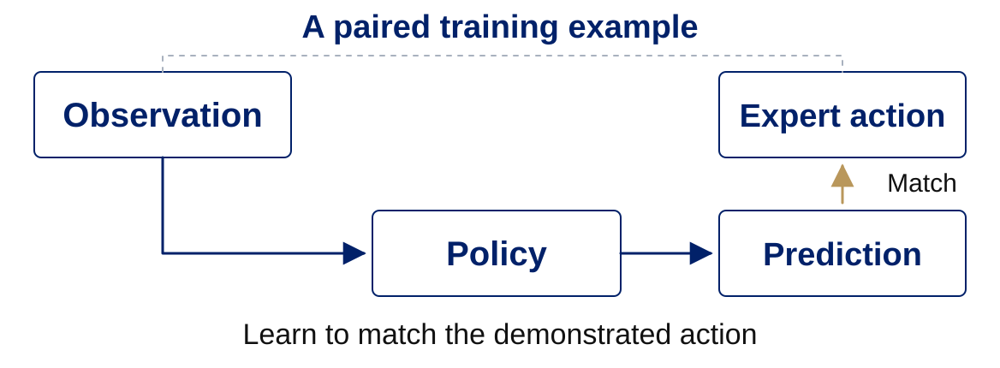{width="100%"}


::: {.footnote}
[Imitation learning · Berkeley CS185/285](https://rail.eecs.berkeley.edu/deeprlcourse/)
:::


## Observation, action, outcome {#record-roles data-chapter="2" data-seconds="27" }

| Role | Coffee example |
|:--|:--|
| Observation | The gripper is open |
| Action | Command the gripper to close |
| Later outcome | The tool is grasped |

::: {.footnote}
Illustrative record, not a recovered control log.
:::


## An action can create an unfamiliar scene {#unfamiliar data-chapter="2" data-seconds="36" }

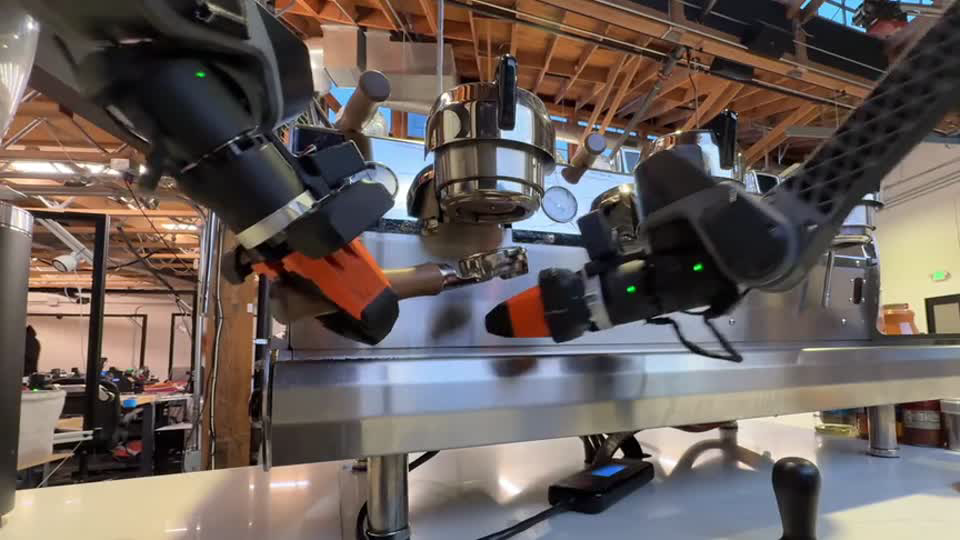{width="100%"}

Next observation differs from the demonstrations

::: {.footnote}
[Physical Intelligence, 2025](https://arxiv.org/abs/2511.14759) · [Ross et al., 2011](https://proceedings.mlr.press/v15/ross11a.html)
:::


## DAgger: Dataset Aggregation {#dagger data-chapter="2" data-seconds="37" }

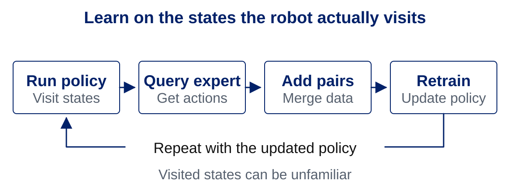{width="100%"}


::: {.footnote}
[Ross et al., 2011](https://proceedings.mlr.press/v15/ross11a.html)
:::


## The expert labels the visited situation {#dagger-label data-chapter="2" data-seconds="45" }

::: {.mechanism}



```{=html}
<div class="build-steps" aria-hidden="true"><span class="fragment build-step" data-fragment-index="0" aria-hidden="true"></span></div>
```

:::

::: {.footnote}
[Physical Intelligence, 2025](https://arxiv.org/abs/2511.14759) · Illustrative correction. Queries can cover successful states too.
:::


## Reinforcement learning (RL) {#reinforcement data-chapter="2" data-seconds="58" }

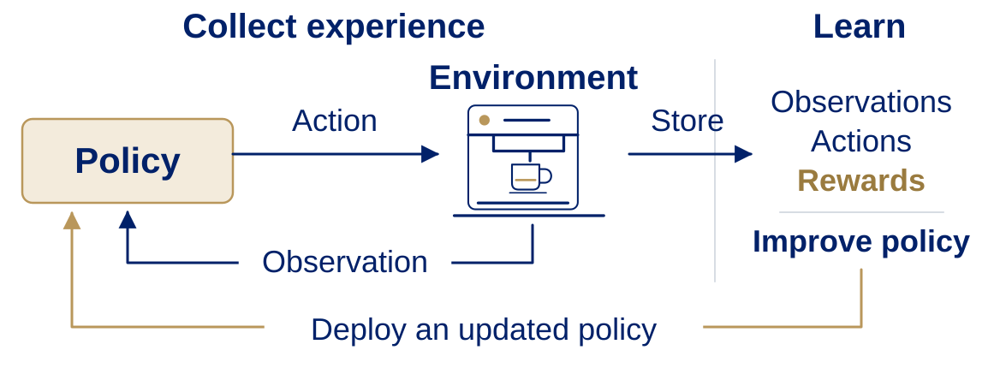{width="100%"}


::: {.footnote}
[MIT 6.S191, 2025](https://introtodeeplearning.com/2025/) · A conceptual reward example
:::


## The consequence can arrive later {#delayed-reward data-chapter="2" data-seconds="46" }

::: {.mechanism}



```{=html}
<div class="build-steps" aria-hidden="true"><span class="fragment build-step" data-fragment-index="0" aria-hidden="true"></span></div>
```

:::


## Collect experience, then learn from it {#collect-learn data-chapter="2" data-seconds="38" }




## Practice in simulation {#locomotion-sim data-chapter="2" data-seconds="15" }




## Execute on a physical robot {#locomotion-real data-chapter="2" data-seconds="44" }




## Different signals can work together {#signal-summary data-chapter="2" data-seconds="45" }

| Approach | Learning signal | Where it falls short |
|:--|:--|:--|
| Self-supervision | The data itself | No action to copy |
| Imitation | Expert actions | Unfamiliar scenes |
| Reinforcement learning | Rewards | Reward design, many attempts |


## 03 · Action sequences {#action-sequences data-chapter="3" data-seconds="40" .roadmap-slide}

```{=html}
<div class="lecture-roadmap" aria-label="Today’s lecture roadmap">
<div class="roadmap-step completed"><span class="roadmap-number">01</span><span>Robot tasks</span></div>
<div class="roadmap-step completed"><span class="roadmap-number">02</span><span>Learning signals</span></div>
<div class="roadmap-step current" aria-current="step"><span class="roadmap-number">03</span><span>Action sequences</span></div>
<div class="roadmap-step upcoming"><span class="roadmap-number">04</span><span>Requests + actions</span></div>
<div class="roadmap-step upcoming"><span class="roadmap-number">05</span><span>Predicted outcomes</span></div>
<div class="roadmap-step upcoming"><span class="roadmap-number">06</span><span>Plans + execution</span></div>
</div>
```

::: {.roadmap-question}
How does a policy produce movement?
:::


## ALOHA: collecting demonstrations {#aloha data-chapter="3" data-seconds="35" }




::: {.footnote}
A Low-cost Open-source Hardware System for Bimanual Teleoperation
:::


## Action Chunking with Transformers (ACT) {#act data-chapter="3" data-seconds="75" }

::: {.mechanism}



```{=html}
<div class="build-steps" aria-hidden="true"><span class="fragment build-step" data-fragment-index="0" aria-hidden="true"></span><span class="fragment build-step" data-fragment-index="1" aria-hidden="true"></span><span class="fragment build-step" data-fragment-index="2" aria-hidden="true"></span></div>
```

:::

::: {.footnote}
[Zhao et al., 2023](https://arxiv.org/abs/2304.13705) · Success rates from the paper's simulated ablation without temporal ensembling
:::


## A chunk is a timed sequence of targets {#chunk-clock data-chapter="3" data-seconds="54" }

::: {.mechanism}



```{=html}
<div class="build-steps" aria-hidden="true"><span class="fragment build-step" data-fragment-index="0" aria-hidden="true"></span><span class="fragment build-step" data-fragment-index="1" aria-hidden="true"></span></div>
```

:::


::: {.footnote}
[Zhao et al., 2023](https://arxiv.org/abs/2304.13705) · Illustrative timeline; animation slowed for explanation
:::


## ACT combines predictions for the same moment {#act-feedback data-chapter="3" data-seconds="64" }

::: {.mechanism}



```{=html}
<div class="build-steps" aria-hidden="true"><span class="fragment build-step" data-fragment-index="0" aria-hidden="true"></span><span class="fragment build-step" data-fragment-index="1" aria-hidden="true"></span><span class="fragment build-step" data-fragment-index="2" aria-hidden="true"></span></div>
```

:::


::: {.footnote}
[Zhao et al., 2023](https://arxiv.org/abs/2304.13705) · Inference time omitted; overlapping target times
:::


## ACT opens a small lid {#act-execution data-chapter="3" data-seconds="25" }




## More than one good way to move {#many-actions data-chapter="3" data-seconds="57" }

:::: {.r-stack}

::: {.fragment .fade-out fragment-index="0"}

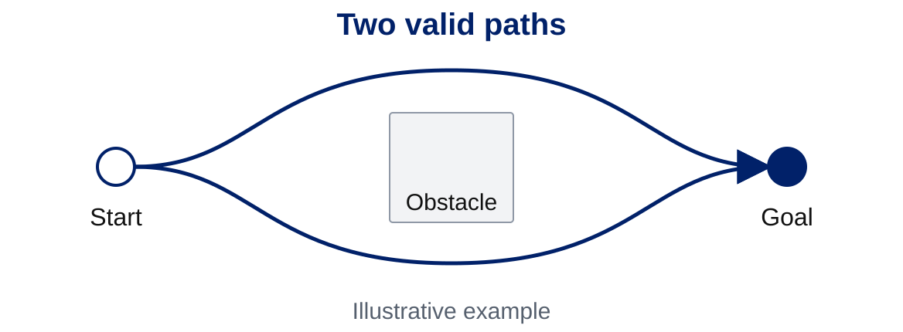{width="100%"}

:::

::: {.fragment fragment-index="0"}

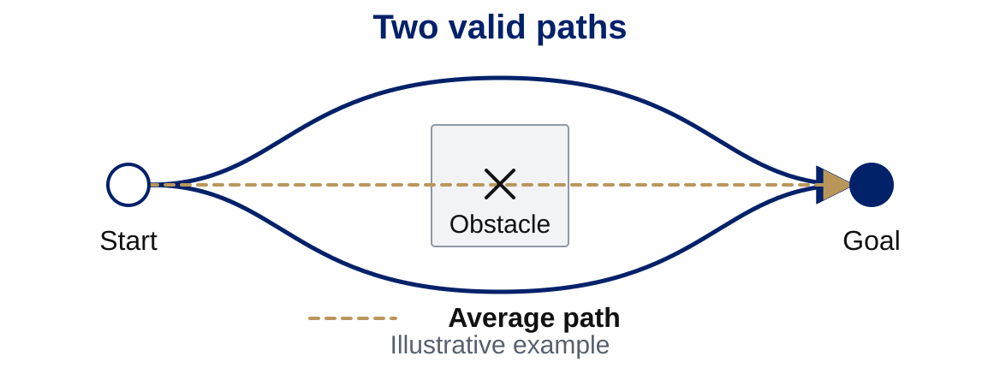{width="100%"}

:::

::::


::: {.footnote}
Illustrative example. [Diffusion Policy · Chi et al., 2023](https://diffusion-policy.cs.columbia.edu/)
:::


## Diffusion models generate by repeated denoising {#diffusion-models data-chapter="3" data-seconds="65" }

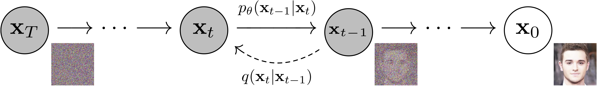{width="100%"}

**Random noise → repeated learned updates → image**

::: {.footnote}
[Ho et al., 2020](https://hojonathanho.github.io/diffusion/) · Original DDPM process figure, unchanged
:::


## Learn a denoising update, then reuse it {#diffusion-training data-chapter="3" data-seconds="48" }

::: {.mechanism}



```{=html}
<div class="build-steps" aria-hidden="true"><span class="fragment build-step" data-fragment-index="0" aria-hidden="true"></span><span class="fragment build-step" data-fragment-index="1" aria-hidden="true"></span></div>
```

:::


::: {.footnote}
[Ho et al., 2020](https://hojonathanho.github.io/diffusion/) · Teaching schematic
:::


## Diffusion Policy denoises an action chunk {#diffusion data-chapter="3" data-seconds="93" }

::: {.mechanism}



```{=html}
<div class="build-steps" aria-hidden="true"><span class="fragment build-step" data-fragment-index="0" aria-hidden="true"></span><span class="fragment build-step" data-fragment-index="1" aria-hidden="true"></span><span class="fragment build-step" data-fragment-index="2" aria-hidden="true"></span></div>
```

:::


::: {.footnote}
[Chi et al., 2023](https://diffusion-policy.cs.columbia.edu/) · Schematic action values, not model output
:::


## ACT vs. Diffusion Policy: how the chunk is made {#candidate-vs-robot data-chapter="3" data-seconds="46" }

::: {.mechanism}



```{=html}
<div class="build-steps" aria-hidden="true"><span class="fragment build-step" data-fragment-index="0" aria-hidden="true"></span></div>
```

:::

::: {.footnote}
[Zhao et al., 2023](https://arxiv.org/abs/2304.13705) · [Chi et al., 2023](https://diffusion-policy.cs.columbia.edu/)
:::


## Predicted actions and actual movement {#dp-process data-chapter="3" data-seconds="17" }




## Diffusion Policy manipulates a mug {#dp-mug data-chapter="3" data-seconds="28" }




## Predict farther than you execute {#execute-prefix data-chapter="3" data-seconds="49" }

::: {.mechanism}



```{=html}
<div class="build-steps" aria-hidden="true"><span class="fragment build-step" data-fragment-index="0" aria-hidden="true"></span><span class="fragment build-step" data-fragment-index="1" aria-hidden="true"></span></div>
```

:::


::: {.footnote}
[Chi et al., 2023](https://arxiv.org/abs/2303.04137) · Illustrative horizons; inference delay omitted here
:::


## Observation and action are separated by delay {#chunk-latency data-chapter="3" data-seconds="46" }

::: {.mechanism}



```{=html}
<div class="build-steps" aria-hidden="true"><span class="fragment build-step" data-fragment-index="0" aria-hidden="true"></span><span class="fragment build-step" data-fragment-index="1" aria-hidden="true"></span></div>
```

:::


::: {.footnote}
[Black et al., 2025](https://arxiv.org/abs/2506.07339) · Illustrative 20 ms commands and 60 ms inference
:::


## Generate the next chunk while the robot moves {#chunk-overlap data-chapter="3" data-seconds="66" }

::: {.mechanism}



```{=html}
<div class="build-steps" aria-hidden="true"><span class="fragment build-step" data-fragment-index="0" aria-hidden="true"></span><span class="fragment build-step" data-fragment-index="1" aria-hidden="true"></span><span class="fragment build-step" data-fragment-index="2" aria-hidden="true"></span></div>
```

:::


::: {.footnote}
[Black et al., 2025](https://arxiv.org/abs/2506.07339) · Illustrative asynchronous timeline
:::


## A smooth handoff also needs compatible actions {#chunk-continuity data-chapter="3" data-seconds="78" }

::: {.mechanism}



```{=html}
<div class="build-steps" aria-hidden="true"><span class="fragment build-step" data-fragment-index="0" aria-hidden="true"></span><span class="fragment build-step" data-fragment-index="1" aria-hidden="true"></span></div>
```

:::


::: {.footnote}
[RTC · Black et al., 2025](https://arxiv.org/abs/2506.07339) · Schematic guidance regions
:::


## Keep the short future, update with feedback {#action-designs data-chapter="3" data-seconds="30" }

| Question | What we just saw |
|:--|:--|
| What teaches it? | Demonstrations |
| What does it output? | A short action chunk |
| How is it generated? | ACT or Diffusion Policy |

**Prepare ahead. Observe again. Update what comes next.**

::: {.footnote}
The examples here learn from demonstrations; these are compatible design choices.
:::


## 04 · Requests + actions {#vla-intro data-chapter="4" data-seconds="30" .roadmap-slide}

```{=html}
<div class="lecture-roadmap" aria-label="Today’s lecture roadmap">
<div class="roadmap-step completed"><span class="roadmap-number">01</span><span>Robot tasks</span></div>
<div class="roadmap-step completed"><span class="roadmap-number">02</span><span>Learning signals</span></div>
<div class="roadmap-step completed"><span class="roadmap-number">03</span><span>Action sequences</span></div>
<div class="roadmap-step current" aria-current="step"><span class="roadmap-number">04</span><span>Requests + actions</span></div>
<div class="roadmap-step upcoming"><span class="roadmap-number">05</span><span>Predicted outcomes</span></div>
<div class="roadmap-step upcoming"><span class="roadmap-number">06</span><span>Plans + execution</span></div>
</div>
```

::: {.roadmap-question}
How can one model handle different requests?
:::


## “Pick up the red marker with the left hand” {#vla-request data-chapter="4" data-seconds="19" }




## Vision-Language Model (VLM) {#vlm data-chapter="4" data-seconds="47" }

::: {.mechanism}



```{=html}
<div class="build-steps" aria-hidden="true"><span class="fragment build-step" data-fragment-index="0" aria-hidden="true"></span></div>
```

:::

::: {.footnote}
[Physical Intelligence, 2026](https://www.pi.website/blog/pi07) · Desk frame from the π0.7 demo; the reply text is illustrative
:::


## Connecting robot experience {#robot-experience data-chapter="4" data-seconds="33" }

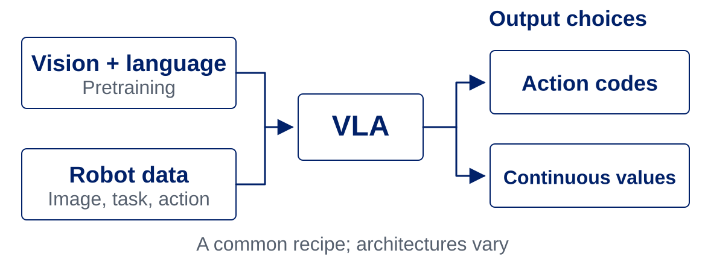{width="100%"}


::: {.footnote}
[OpenVLA · Kim et al., 2024](https://openvla.github.io/) · Conceptual training inputs
:::


## These choices can live in one model {#vla-action-design data-chapter="4" data-seconds="43" }

**VLA: observation + instruction → action**

| Design question | Compatible choices |
|:--|:--|
| How does it learn? | Imitation, RL |
| What does it output? | Individual actions, chunks |
| How does it generate them? | Token prediction, diffusion |


::: {.footnote}
Teaching synthesis · [Bai et al., 2026](https://arxiv.org/html/2512.22983v2) · [OpenVLA](https://openvla.github.io/) · [π0](https://www.pi.website/blog/pi0)
:::


## One foundation, many tasks {#foundation-coffee data-chapter="4" data-seconds="19" }




## Robot Foundation Model (RFM) {#rfm data-chapter="4" data-seconds="44" }



::: {.footnote}
[Google DeepMind, 2026](https://deepmind.google/blog/gemini-robotics-2-brings-whole-body-intelligence-to-robots/) · One on-device VLA, adapted to each robot type with a few hours of data (publisher description)
:::


## What changed in the test? {#transfer data-chapter="4" data-seconds="42" }

- New scene: cup color or position
- New task: a different request
- New robot: a different arm or gripper

What extra experience did the model receive?


## Can experience improve reliability? {#recap-return data-chapter="4" data-seconds="35" }




## RECAP: experience and corrections {#recap-experience data-chapter="4" data-seconds="46" }



::: {.footnote}
[RECAP · Physical Intelligence, 2025](https://arxiv.org/abs/2511.14759)<br>RL with Experience and Corrections via Advantage-conditioned Policies
:::


## Learning to evaluate progress {#value data-chapter="4" data-seconds="35" .value-figure}

```{=html}
<div class="value-phase-labels"><span>Repeated drops</span><span>Progress resumes</span></div>
<div class="value-viewport">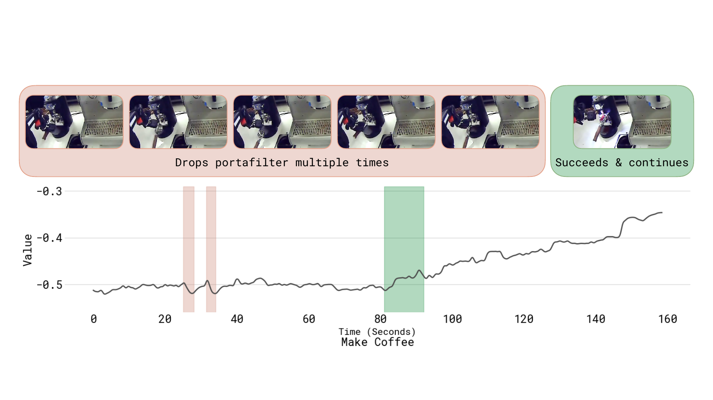</div>
<div class="value-axis-labels"><span>Learned value ↑</span><span>Time →</span></div>
```

::: {.footnote}
[Physical Intelligence, 2025](https://arxiv.org/abs/2511.14759) · Original figure, only empty margins outside the viewport
:::


## Using evaluation to improve actions {#advantage data-chapter="4" data-seconds="46" }

::: {.mechanism}



```{=html}
<div class="build-steps" aria-hidden="true"><span class="fragment build-step" data-fragment-index="0" aria-hidden="true"></span></div>
```

:::

::: {.footnote}
[RECAP · Physical Intelligence, 2025](https://arxiv.org/abs/2511.14759) · Illustrative attempts
:::


## Collect, learn, deploy again {#recap-loop data-chapter="4" data-seconds="35" }

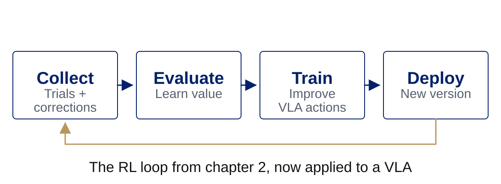{width="100%"}


::: {.footnote}
[RECAP · Physical Intelligence, 2025](https://arxiv.org/abs/2511.14759)
:::


## Successful espressos per hour {#throughput data-chapter="4" data-seconds="42" }

```{=html}
<div class="espresso-comparison">
  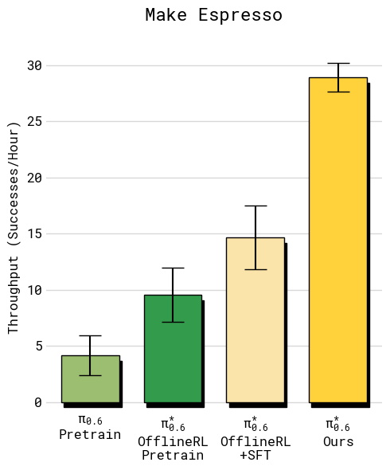
  <div class="espresso-key">
    <div class="espresso-key-row"><span class="espresso-swatch espresso-sft" aria-label="Pale yellow, third original bar"></span><div><p><strong>Task demonstrations</strong></p><p>On the pretrained model</p></div></div>
    <div class="espresso-key-row"><span class="espresso-swatch espresso-recap" aria-label="Yellow, fourth original bar"></span><div><p><strong>+ RECAP experience</strong></p><p>Attempts and corrections</p></div></div>
  </div>
</div>
```

::: {.footnote}
[Physical Intelligence, 2025](https://arxiv.org/abs/2511.14759) · Original result. SFT: Supervised Fine-Tuning. Throughput: successes per hour.
:::


## Experience can teach actions and consequences {#prediction-bridge data-chapter="4" data-seconds="44" }

```{=html}
<div class="source-bridge">
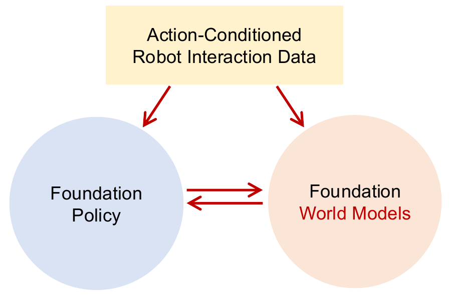
<div><p><strong>Policy</strong><br>Choose an action</p><p><strong>World model</strong><br>Predict its consequences</p></div>
</div>
```
::: {.footnote}
[Yunzhu Li, Stanford CS231n, 2025, slide 96](https://cs231n.stanford.edu/slides/2025/lecture_17.pdf#page=96) · Original diagram; surrounding title and footer cropped
:::


## 05 · Predicted outcomes {#world-models data-chapter="5" data-seconds="38" .roadmap-slide}

```{=html}
<div class="lecture-roadmap" aria-label="Today’s lecture roadmap">
<div class="roadmap-step completed"><span class="roadmap-number">01</span><span>Robot tasks</span></div>
<div class="roadmap-step completed"><span class="roadmap-number">02</span><span>Learning signals</span></div>
<div class="roadmap-step completed"><span class="roadmap-number">03</span><span>Action sequences</span></div>
<div class="roadmap-step completed"><span class="roadmap-number">04</span><span>Requests + actions</span></div>
<div class="roadmap-step current" aria-current="step"><span class="roadmap-number">05</span><span>Predicted outcomes</span></div>
<div class="roadmap-step upcoming"><span class="roadmap-number">06</span><span>Plans + execution</span></div>
</div>
```

::: {.roadmap-question}
What might happen after an action?
:::


## The action changes the predicted outcome {#counterfactual data-chapter="5" data-seconds="55" }

:::: {.counterfactual-rows}

::: {.action-row-labels}

Closed gripper

Open gripper

:::

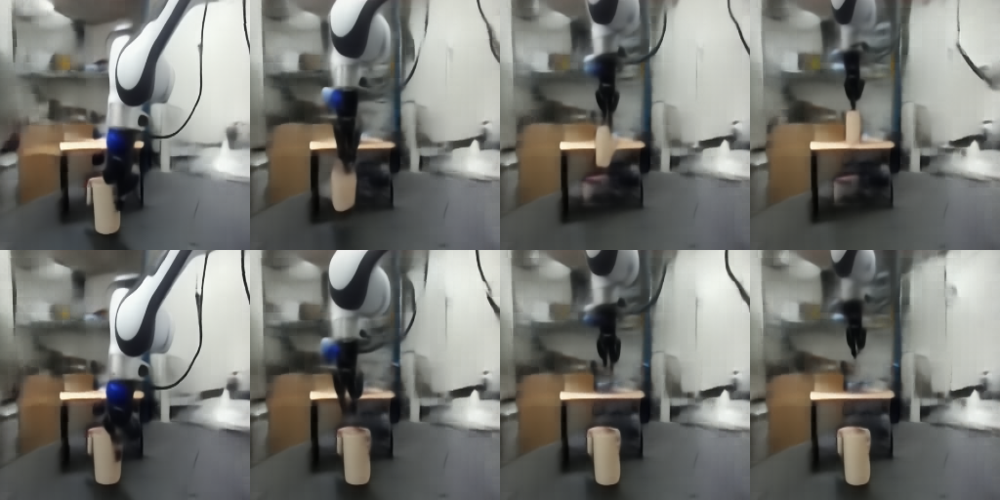{width="100%"}

::::

**Both rows show model predictions.**

::: {.footnote}
[V-JEPA 2 · Assran et al., 2025](https://arxiv.org/abs/2506.09985) · Video Joint Embedding Predictive Architecture
:::


## Compare predicted outcomes, then act {#imagined-options data-chapter="5" data-seconds="46" }

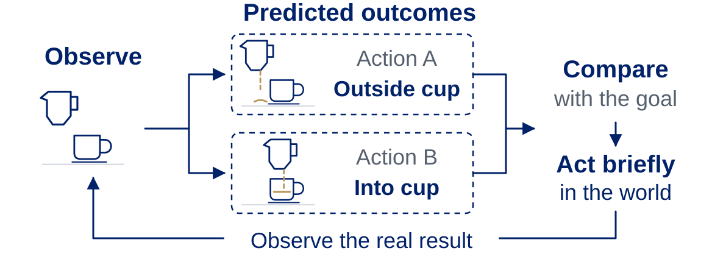{width="100%"}


::: {.footnote}
[Model predictive control · Stanford CS231n, 2025](https://cs231n.stanford.edu/slides/2025/lecture_17.pdf#page=55) · Illustrative plan
:::


## World Action Model (WAM) {#wam data-chapter="5" data-seconds="50" }

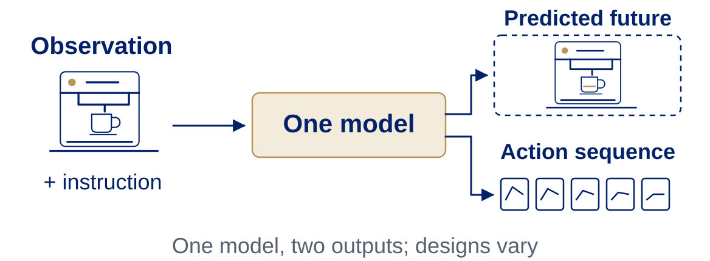{width="100%"}


::: {.footnote}
A conceptual family of designs. [DreamZero, 2026](https://arxiv.org/abs/2602.15922)
:::


## DreamZero: future video and robot actions {#dreamzero data-chapter="5" data-seconds="49" }

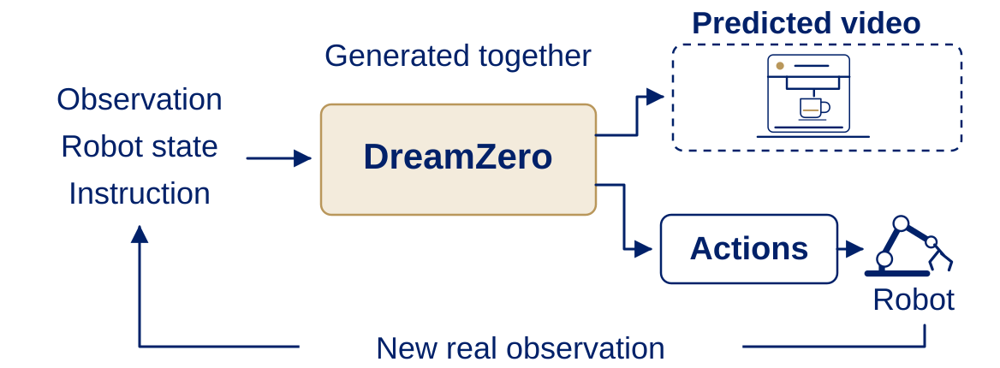{width="100%"}


::: {.footnote}
[DreamZero, 2026](https://arxiv.org/abs/2602.15922) · Simplified inference; coffee icon is illustrative
:::


## Generated future {#predicted-video data-chapter="5" data-seconds="15" }




::: {.footnote}
⚠ Example flagged by the authors. This video is generated, not recorded.
:::


## Physical execution {#observed-video data-chapter="5" data-seconds="26" }




::: {.footnote}
⚠ Example flagged by the authors. This is the observed robot execution.
:::


## Prediction returns to observation {#reality data-chapter="5" data-seconds="33" }

Predict → Act → Observe

[What should happen next in the whole task?]{.statement}


## 06 · Plans + execution {#dual-intro data-chapter="6" data-seconds="31" .roadmap-slide}

```{=html}
<div class="lecture-roadmap" aria-label="Today’s lecture roadmap">
<div class="roadmap-step completed"><span class="roadmap-number">01</span><span>Robot tasks</span></div>
<div class="roadmap-step completed"><span class="roadmap-number">02</span><span>Learning signals</span></div>
<div class="roadmap-step completed"><span class="roadmap-number">03</span><span>Action sequences</span></div>
<div class="roadmap-step completed"><span class="roadmap-number">04</span><span>Requests + actions</span></div>
<div class="roadmap-step completed"><span class="roadmap-number">05</span><span>Predicted outcomes</span></div>
<div class="roadmap-step current" aria-current="step"><span class="roadmap-number">06</span><span>Plans + execution</span></div>
</div>
```

::: {.roadmap-question}
Who chooses the next task?
:::


## Two modes of human thinking {#human-thinking data-chapter="6" data-seconds="36"}

:::: {.columns}
::: {.column width="48%"}
**System 1**

Fast, automatic

Recognize your familiar mug.
:::
::: {.column width="48%"}
**System 2**

Deliberate, effortful

Plan around a broken coffee machine.
:::
::::

A way to describe thinking, not two separate brain modules.

::: {.footnote}
[Stanovich & West (2000)](https://static.cambridge.org/content/id/urn:cambridge.org:id:article:S0140525X00243434/resource/name/S0140525X00003435a.pdf#page=14) · [Kahneman, *Thinking, Fast and Slow* (2011)](https://us.macmillan.com/books/9780374275631/thinkingfastandslow/)
:::


## Two systems, connected by feedback {#dual-system data-chapter="6" data-seconds="40" }

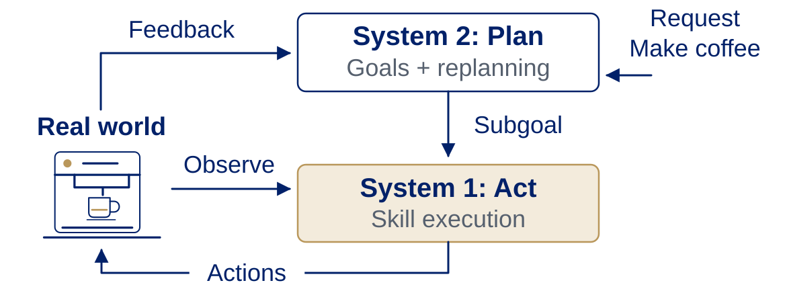{width="100%"}


::: {.footnote}
System 2: goals and plans. System 1: separate action execution.
:::


## The result can change the next subgoal {#replan data-chapter="6" data-seconds="46" }

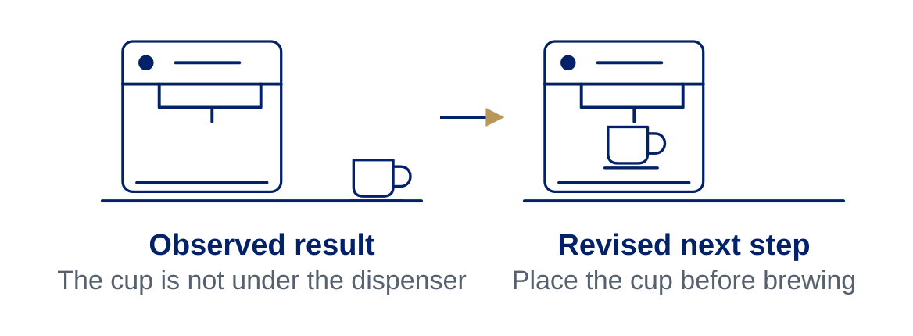{width="100%"}


## Hi Robot: VLM and VLA {#hirobot data-chapter="6" data-seconds="32" }

```{=html}
<div class="hirobot-guide">
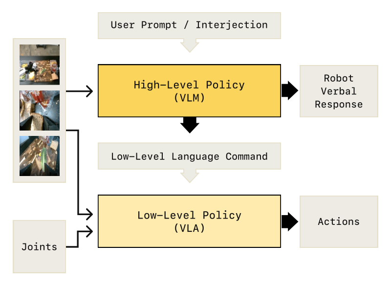
<div><p><strong>VLM: choose the next task</strong></p><p>↓ Instruction</p><p><strong>VLA: execute the task</strong></p></div>
</div>
```


::: {.footnote}
[Hi Robot, 2025](https://arxiv.org/abs/2502.19417)
:::


## “Get me something sweet that’s not in the basket” {#hirobot-demo data-chapter="6" data-seconds="22" }




## Three routes to robot action {#robodojo data-chapter="6" data-seconds="40"}

| RoboDojo-Sim model | Score | Success |
|:--|--:|--:|
| PhysicalRSI | 36.27 | 31.38% |
| GPT-6 Astra | 28.97 | 22.48% |
| VPP2 | 39.26 | 32.26% |

Different systems. Three selected successful rollouts.

::: {.footnote}
[RoboDojo leaderboard](https://robodojo-benchmark.com/leaderboard) · Average, including Agent entries · v2026.10.9, checked Oct 12, 2026
:::


## PhysicalRSI: planning and separate execution {#physicalrsi-system data-chapter="6" data-seconds="60"}

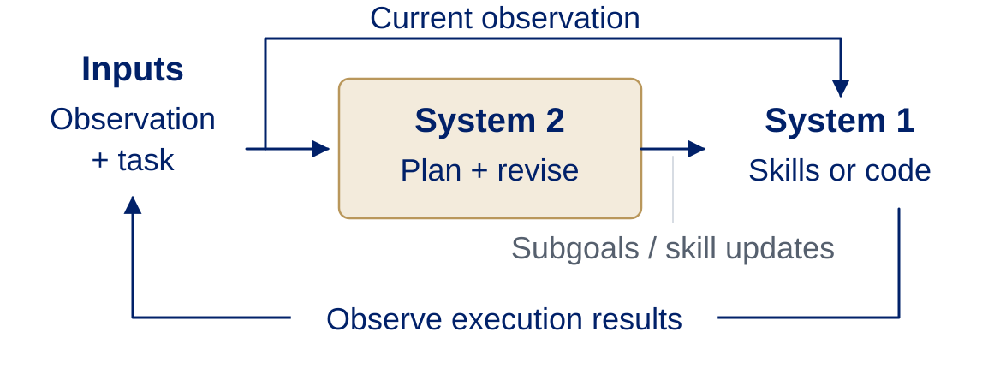{width="100%"}

::: {.footnote}
[PhysicalRSI 1.0](https://mmlab.hk/research/PhysicalRSI) · Skills can include a VLA or code policies
:::


## PhysicalRSI: align and insert a key {#physicalrsi-demo data-chapter="6" data-seconds="21"}




## GPT-6 Astra: from images to movement targets {#astra-control data-chapter="6" data-seconds="40"}

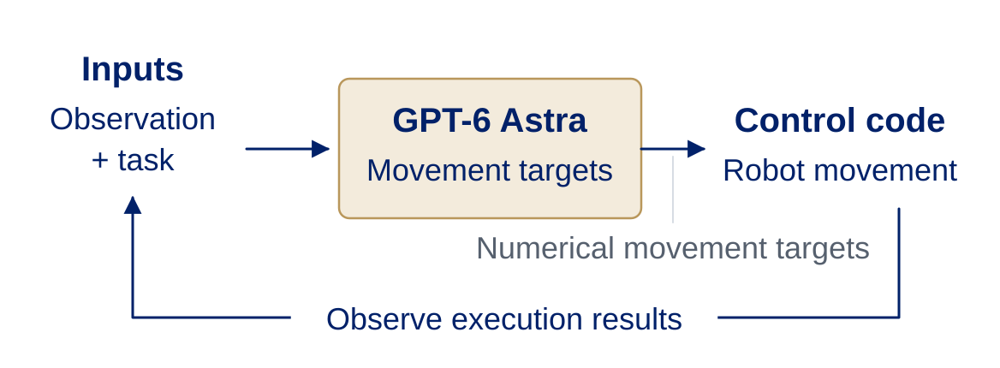{width="100%"}

No separate learned motor policy in this evaluation.

::: {.footnote}
[RoboDojo Astra evaluation](https://robodojo-benchmark.com/report/gpt-6-astra-eval) · [Evaluation paper](https://arxiv.org/abs/2609.24170)
:::


## Astra: read the counts, then press {#astra-demo data-chapter="6" data-seconds="24"}




## VPP2: video prediction supports action {#vpp2-model data-chapter="6" data-seconds="36"}

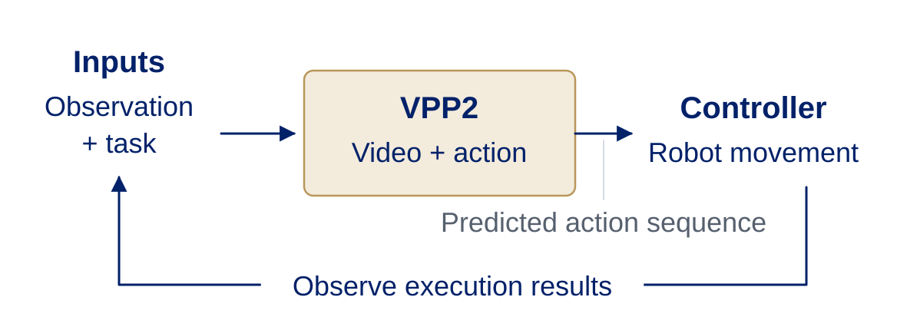{width="100%"}

::: {.footnote}
[VPP2: Video Prediction Policy 2 (2026)](https://arxiv.org/abs/2610.10270) · Separate VLM planner evaluated elsewhere
:::


## VPP2: place bread in both toaster slots {#vpp2-demo data-chapter="6" data-seconds="46"}




## Reasoning, skills and feedback {#interfaces data-chapter="6" data-seconds="29" }

| Model | What it produces | What executes it |
|:--|:--|:--|
| PhysicalRSI | Plans and skills | Skills / code |
| GPT-6 Astra | Movement targets | Control code |
| VPP2 | Action sequences | Robot controller |

All three use feedback from execution.


## Back to the dropped coffee tool {#coffee-again data-chapter="7" data-seconds="28" }




## Recover now. Learn for the next attempt. {#three-questions data-chapter="7" data-seconds="34" }

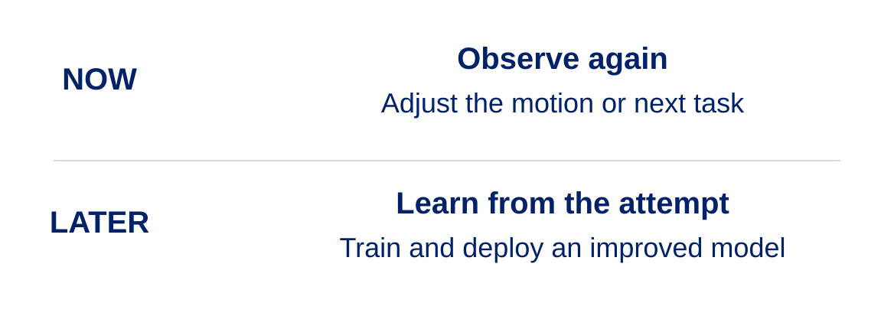{width="100%"}


## What did it learn, and how does it act? {#questions data-chapter="7" data-seconds="33" .qr-slide}



Leave a question. Answers follow after the lecture.


##  {#backup data-chapter="0" data-seconds="11" .divider}

::: {.divider-number}
\+
:::

::: {.divider-title}
Further detail
:::

::: {.divider-sub}
Reference material after the lecture
:::


## Locomotion on a changing surface {#backup-rma data-chapter="0" data-seconds="22" }




## Navigation among obstacles {#backup-navigation data-chapter="0" data-seconds="21" }




## ACT: architecture and temporal ensembling {#backup-act data-chapter="0" data-seconds="49"}

:::: {.r-stack .act-detail-stack}

::: {.fragment .fade-out fragment-index="0"}

<div class="act-architecture-viewport">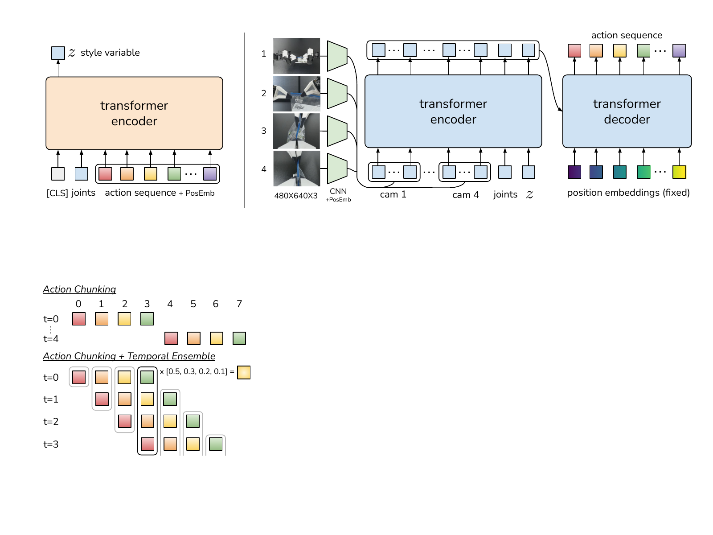</div>

:::

::: {.fragment fragment-index="0"}

<div class="act-timeline-viewport"></div>

:::

::::

::: {.footnote}
[Zhao et al., 2023](https://arxiv.org/abs/2304.13705) · Enlarged original panels · [Full original figure](../../Figures/lectures/dgist-2026f-w09/originals/act-architecture.png)
:::


## Diffusion Policy: prediction and execution {#backup-dp data-chapter="0" data-seconds="32" }

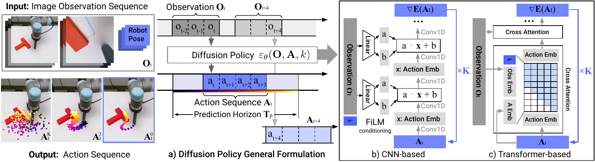{width="100%"}


::: {.footnote}
[Chi et al., 2023](https://arxiv.org/abs/2303.04137)
:::


## DreamZero: original architecture {#backup-dreamzero data-chapter="0" data-seconds="26" }

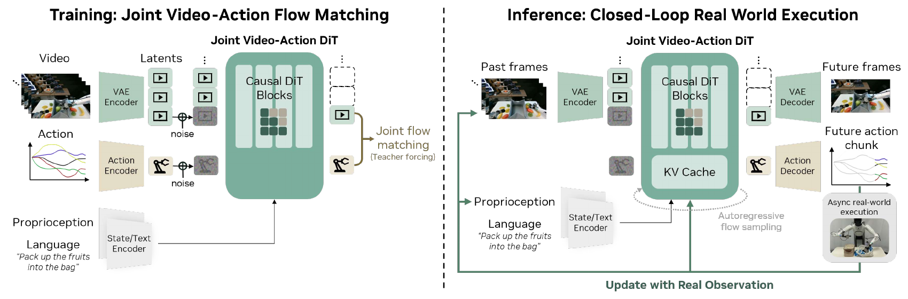{width="100%"}


::: {.footnote}
[DreamZero, 2026](https://arxiv.org/abs/2602.15922)
:::


## World prediction at training and execution {#backup-wam data-chapter="0" data-seconds="35" }

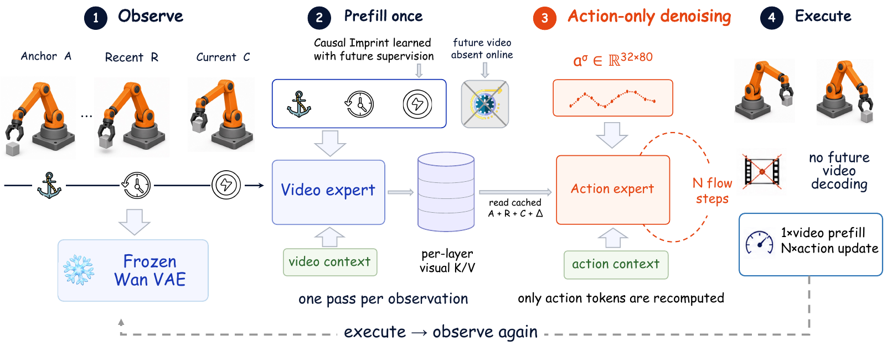{width="100%"}

Train with future video. Execute with actions.


::: {.footnote}
[InternW0-Delta, 2026](https://arxiv.org/abs/2609.31394)
:::


## Learning and action modeling: the survey view {#backup-survey-map data-chapter="0" data-seconds="19" }

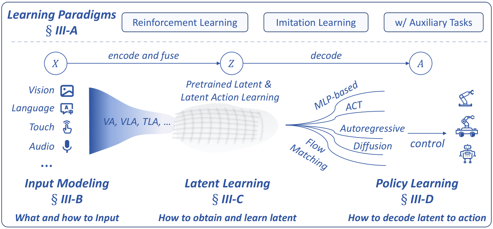{width="100%"}

::: {.footnote}
[Bai et al., 2026, Fig. 5](https://arxiv.org/html/2512.22983v2#S3.F5) · Unchanged original · CC BY 4.0
:::


## Selected references {#references data-chapter="0" data-seconds="0" }

- [ALOHA and ACT](https://tonyzhaozh.github.io/aloha/) · [Diffusion Policy](https://diffusion-policy.cs.columbia.edu/)
- [π0.7](https://www.pi.website/blog/pi07) · [RECAP](https://arxiv.org/abs/2511.14759)
- [V-JEPA 2](https://arxiv.org/abs/2506.09985) · [DreamZero](https://dreamzero0.github.io/)
- [Hi Robot](https://hi-robot-vla.github.io/) · [PhysicalRSI](https://mmlab.hk/research/PhysicalRSI) · [Astra](https://arxiv.org/abs/2609.24170) · [VPP2](https://arxiv.org/abs/2610.10270)


## Surveys and learning resources {#reading data-chapter="0" data-seconds="0" }

- Surveys: [Hu et al., 2024](https://arxiv.org/html/2312.08782v3) · [Bai et al., 2026](https://arxiv.org/html/2512.22983v2) · [Hou et al., 2026](https://arxiv.org/html/2605.00080v1)
- Learning resources: [Stanford CS231n, Lecture 17](https://cs231n.stanford.edu/slides/2025/lecture_17.pdf) · [Hugging Face Robotics Course](https://huggingface.co/learn/robotics-course/en/unit0/1)
