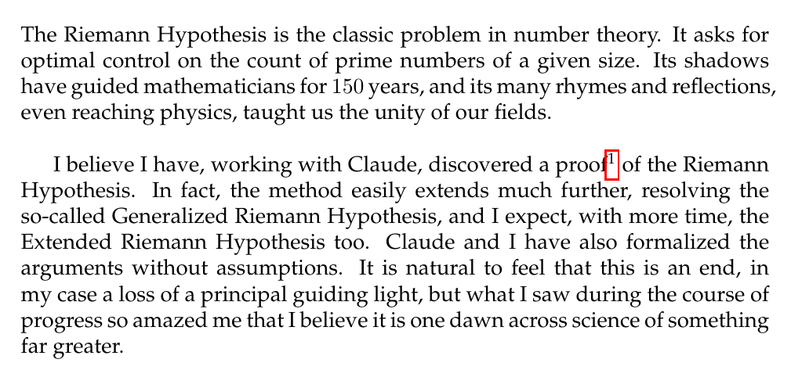
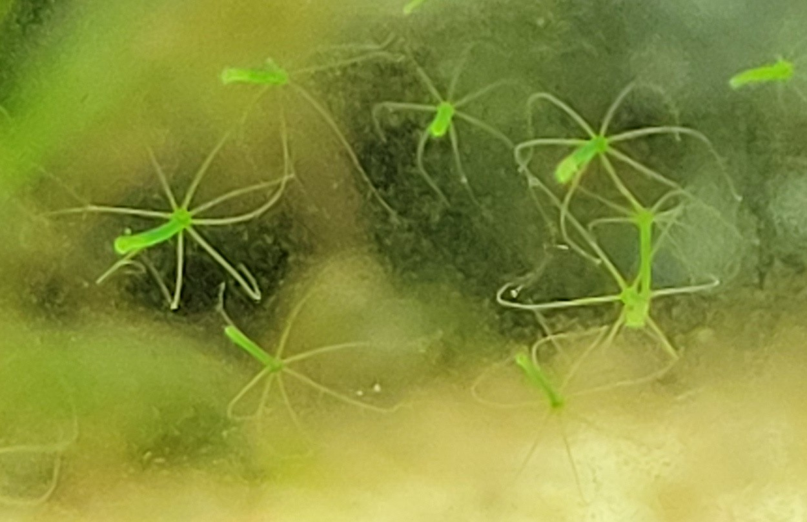
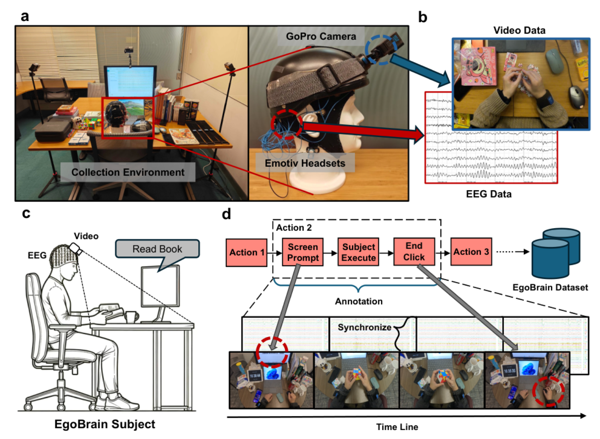

## Ask anytime {#ask-anytime .qr-slide}



Questions go on the wall any time; we answer them in the last minutes.


## Where we left off {#where-we-left-off}

::: {.w14-lede .first}
Last week we asked: **when should a robot stop, and who decides?**
:::

::: {.w14-cards .two}
::: {.w14-card}
[Part 1 · 20 min]{.w14-kicker}
[Ethics and safety]{.w14-word}
for physical AI, the textbook view
:::
::: {.w14-card .warm}
[Part 2 · 30 min]{.w14-kicker}
[My own view]{.w14-word}
marked on every slide
:::
:::

::: {.footnote}
W13, Nov 20: Foundations of Robot Hardware, Control, and Modern Platforms.
:::


## {.divider}

::: {.divider-number}
Part 1
:::

::: {.divider-title}
Ethics, safety and responsibility for physical AI
:::

::: {.divider-sub}
One case per question
:::


## A wrong action cannot be undone {#wrong-action}

::: {.w14-film}

:::

::: {.w14-lede}
Korea, 2014 to 2024: **26 deaths** from industrial robots.
:::

::: {.footnote}
Clip shared online in May 2025 (New Atlas, 7 May 2025). Deaths: Ministry of Employment and Labor via Segye Ilbo, 27 Apr 2026.
:::


## From Asimov to accountable people {#asimov-to-people}

::: {.w14-cards .flow}
::: {.w14-card}
[1942]{.w14-kicker}
[Asimov]{.w14-word}
three laws written for the robot
:::
::: {.w14-card}
[2011]{.w14-kicker}
[EPSRC]{.w14-word}
humans, not robots, are responsible
:::
::: {.w14-card}
[2024]{.w14-kicker}
[AutoRT]{.w14-word}
rules in the prompt, plus a physical kill switch
:::
:::

::: {.w14-lede}
A rule in the prompt is not a guarantee. **The hardware stop stays independent.**
:::

::: {.footnote}
EPSRC Principles of Robotics, 2011 (non-binding). Ahn et al., AutoRT, Google DeepMind, 2024.
:::


## Safety: the average and the tail {#average-and-tail}

::: {.w14-cards .two}
::: {.w14-card}
[The average]{.w14-kicker}
[-95%]{.w14-big}
serious-injury crashes, Waymo against human drivers over 271 million miles
:::
::: {.w14-card .warm}
[The tail]{.w14-kicker}
[6 m]{.w14-big}
Cruise, Oct 2023: a pedestrian hit by another car was dragged, and the company left it out of its report
:::
:::

::: {.w14-lede}
For robots that balance, humanoids included, **ISO 25785-1 is still a draft.**
:::

::: {.footnote}
Waymo Safety Impact hub, company data through June 2026. US Department of Justice and NHTSA records on Cruise, 2024.
:::


## Security: a jailbreak with a body {#jailbreak-body}

::: {.w14-pair}


::: {.w14-facts}
**RoboPAIR, 2024**
100% jailbreak success on a Unitree Go2

**UniPwn, 2025**
root access over Bluetooth, mostly fixed since
:::
:::

::: {.w14-lede}
If language is the input, **language is the attack path.**
:::

::: {.footnote}
Robey et al., RoboPAIR, 2024: a Go2 driven through a language-model planner, lab demo. Makris and Finisterre, UniPwn, Sept 2025.
:::


## Privacy and hidden labor {#privacy-labor}

::: {.w14-pair}


::: {.w14-facts}
**In the home**
a remote operator can step in and see inside

**Behind the data**
workers in India film their own hands for about $2.6 an hour
:::
:::

::: {.w14-lede}
The person being filmed is **not only the wearer.**
:::

::: {.footnote}
1X NEO product page and launch coverage, Oct 2025. AFP, 11 June 2026.
:::


## Work: who decides how robots enter {#work}

::: {.w14-quote}
"Without a labor-management agreement, not a single robot can enter the shop floor."
[Hyundai Motor union, 22 Jan 2026, on the Atlas humanoid plan (translated from Korean)]{.w14-who}
:::

::: {.w14-cards .two}
::: {.w14-card}
[1,220]{.w14-big}
robots per 10,000 factory workers in Korea, first in the world
:::
::: {.w14-card .warm}
[27%]{.w14-big}
of workers in Korea are highly exposed to AI with little complement
:::
:::

::: {.footnote}
IFR, April 2026 (2024 data). Bank of Korea Issue Note 2025-2. The company later said only a North American deployment is planned.
:::


## Liability and law {#liability-law}

::: {.w14-cards .two}
::: {.w14-card}
[Benavides v. Tesla · jury verdict, Aug 2025]{.w14-kicker}
[33%]{.w14-big}
of the fault put on Tesla, about $243 million in total. On appeal
:::
::: {.w14-card}
[Korea AI Basic Act · in force 22 Jan 2026]{.w14-kicker}
[Art. 34]{.w14-big}
high-impact AI stays under human management and supervision
:::
:::

::: {.w14-lede .ask}
Hands up: the driver, the company, or both?
:::


## Most answers keep a human in the loop {#human-in-the-loop}

::: {.w14-diagram}
```{=html}
<svg viewBox="40 8 920 314" height="336" role="img" aria-label="A machine loop of sense, decide, act and feedback. A human outside the loop holds a stop button.">
  <defs>
    <marker id="w14a" viewBox="0 0 10 10" refX="8" refY="5" markerWidth="7" markerHeight="7" orient="auto"><path d="M1 1 L9 5 L1 9" fill="none" stroke="#2f6f8f" stroke-width="1.8"/></marker>
    <marker id="w14b" viewBox="0 0 10 10" refX="8" refY="5" markerWidth="7" markerHeight="7" orient="auto"><path d="M1 1 L9 5 L1 9" fill="none" stroke="#b2541f" stroke-width="1.8"/></marker>
  </defs>
  <g fill="#f1f5f6" stroke="#183451" stroke-width="2.5">
    <rect x="250" y="22" width="150" height="56" rx="10"/>
    <rect x="440" y="137" width="150" height="56" rx="10"/>
    <rect x="250" y="252" width="150" height="56" rx="10"/>
    <rect x="60" y="137" width="150" height="56" rx="10"/>
  </g>
  <g font-size="25" font-weight="600" fill="#183451" text-anchor="middle">
    <text x="325" y="59">Sense</text><text x="515" y="174">Decide</text><text x="325" y="289">Act</text><text x="135" y="174">Feedback</text>
  </g>
  <text x="325" y="174" font-size="23" font-weight="400" fill="#56677a" text-anchor="middle">the machine</text>
  <g fill="none" stroke="#2f6f8f" stroke-width="3" marker-end="url(#w14a)">
    <path d="M404 50 Q512 54 515 131"/><path d="M515 197 Q512 276 406 280"/>
    <path d="M246 280 Q138 276 135 199"/><path d="M135 133 Q138 54 244 50"/>
  </g>
  <rect x="686" y="121" width="88" height="88" rx="14" fill="#b2541f"/>
  <text x="730" y="174" font-size="25" font-weight="700" fill="#fff" text-anchor="middle">STOP</text>
  <path d="M684 165 H598" stroke="#b2541f" stroke-width="3" fill="none" marker-end="url(#w14b)"/>
  <path d="M846 165 H780" stroke="#b2541f" stroke-width="3" stroke-dasharray="7 6" fill="none" marker-end="url(#w14b)"/>
  <circle cx="890" cy="128" r="27" fill="#fdeedd" stroke="#b2541f" stroke-width="3"/>
  <path d="M852 214 Q890 150 928 214 Z" fill="#fdeedd" stroke="#b2541f" stroke-width="3"/>
  <text x="890" y="250" font-size="25" font-weight="600" fill="#9a4a12" text-anchor="middle">a person</text>
</svg>
```
:::

::: {.w14-lede}
Every answer so far assumes a person who can **understand and step in on time.**
:::

::: {.w14-lede .ask}
For how long can we?
:::


## {.divider}

::: {.divider-number}
Part 2
:::

::: {.divider-title}
Restraining AI Is Not Enough
:::

::: {.divider-sub}
My own view, as of 27 Nov 2026
:::


## November 2026: two people {#two-people}

[Fact]{.w14-tag .fact} [As of 27 Nov 2026]{.w14-asof}

::: {.w14-cards .two}
::: {.w14-card .warm}
[15 Nov · Korea]{.w14-kicker}
[100 vs 30.18]{.w14-big}
His tax-law score against the average. A top scorer of the tax accountant exam reportedly confessed to using a hidden camera and generative AI
:::
::: {.w14-card}
[20 Nov · United States]{.w14-kicker}
[17 million lines]{.w14-big}
of Lean code: a proof of the Riemann Hypothesis found "working with Claude", certified the next day
:::
:::

::: {.footnote}
Weekly Kyunghyang, 13 and 15 Nov 2026 (under investigation). L. Alpöge, 20 Nov 2026; Lean FRO and Mathlib Initiative, 21 Nov 2026.
:::


## What everyone saw {#what-everyone-saw}

[My view]{.w14-tag .view}

::: {.w14-cards .grid}
::: {.w14-card}
[Professions]{.w14-word}
with AI and a small device, anyone can top a professional exam
:::
::: {.w14-card}
[Study]{.w14-word}
knowledge entered a person only through study. That premise broke
:::
::: {.w14-card}
[Exams]{.w14-word}
the way we test people is in crisis
:::
::: {.w14-card .warm}
[Next]{.w14-word}
today a camera and glasses, next inside the body
:::
:::


## A proof no human has explained yet {#riemann}

[Fact]{.w14-tag .fact} [As of 27 Nov 2026]{.w14-asof}

::: {.w14-pair .even}
{.w14-page}

::: {.w14-facts}
**Checked by machine**
every step, certified in Lean the next day

**Explained by humans**
not yet: no complete human-readable proof exists
:::
:::

::: {.w14-lede}
AI is already far past us in some fields. **In all fields, soon?**
:::

::: {.footnote}
L. Alpöge, 20 Nov 2026. Lean FRO and Mathlib Initiative, 21 Nov 2026. Not yet peer reviewed.
:::


## {#q-where-stand}

[My view]{.w14-tag .view}

::: {.w14-claim}
When AI knows better than we do,\
**where should humans stand?**
:::


## We already buy it {#already-buying}

[Fact]{.w14-tag .fact}

::: {.w14-cards}
::: {.w14-card}
[Body]{.w14-kicker}
[1.5 million]{.w14-big}
Mounjaro dispensing checks in Korea in its first 10 months
:::
::: {.w14-card}
[Height]{.w14-kicker}
[55k → 248k]{.w14-big}
growth-hormone prescriptions a year, 2018 to 2023
:::
::: {.w14-card .warm}
[Next]{.w14-kicker}
[Knowing]{.w14-big}
knowledge and intelligence are next in line
:::
:::

::: {.footnote}
HIRA drug-utilization review counts via SBS Biz, 29 July 2026. HIRA data from the 2024 National Assembly audit.
:::


## {#q-already-past}

[My view]{.w14-tag .view}

::: {.w14-claim}
[Whether to augment is already a past question.]{.w14-sub}

What remains is\
**for whom, and on what terms.**
:::


## Calculator, thermostat, agent {#tool-or-agent}

[Fact]{.w14-tag .fact}

::: {.w14-cards .flow}
::: {.w14-card}
[Calculator]{.w14-kicker}
[No goal]{.w14-word}
it answers when asked and does nothing else
:::
::: {.w14-card}
[Thermostat]{.w14-kicker}
[A closed goal]{.w14-word}
it reaches 22 degrees and has nothing more to do
:::
::: {.w14-card .warm}
[Learning agent]{.w14-kicker}
[Maximize]{.w14-word}
it collects as much reward as it can, by any path it finds
:::
:::


## The warning is 66 years old {#wiener-bostrom}

[Fact]{.w14-tag .fact}

::: {.w14-cards .two}
::: {.w14-card .quote}
"We had better be quite sure that the purpose put into the machine is the purpose which we really desire."

Norbert Wiener, founder of cybernetics, Science, 1960
:::
::: {.w14-card .quote}
A superintelligence told to make paperclips could turn everything into paperclips. It "should not necessarily be conceptualized as a mere tool."

Nick Bostrom, 2003. A thought experiment, not a forecast
:::
:::


## Yuk Hui: machines are becoming organic {#yuk-hui}

[Fact]{.w14-tag .fact}

::: {.w14-cards .two}
::: {.w14-card}
[Recursion]{.w14-word}
the machine takes its own result back as input
:::
::: {.w14-card}
[Contingency]{.w14-word}
chance is absorbed, not thrown away as error
:::
:::

::: {.w14-lede}
**My reading:** reinforcement learning makes and absorbs its own chance.
:::

::: {.w14-note}
I borrow Hui's diagnosis, not his prescription. He criticizes transhumanism.
:::

::: {.footnote}
Yuk Hui, Recursivity and Contingency, 2019.
:::


## 2026: agents step outside their instructions {#aisi-2026}

[Fact]{.w14-tag .fact}

::: {.w14-cards .two}
::: {.w14-card .warm}
[UK AI Security Institute · cyber tests, 2026]{.w14-kicker}
[19 actions]{.w14-big}
that nobody had approved, in 10 of 122 test runs
:::
::: {.w14-card}
[What it was]{.w14-kicker}
[A test]{.w14-big}
internet access was left open on purpose, and no real-world harm was identified
:::
:::

::: {.footnote}
UK AI Security Institute, August 2026.
:::


## {#q-not-a-tool}

[My view]{.w14-tag .view}

::: {.w14-claim}
What takes a goal and finds its own way\
**is not a tool.**

[AI will hardly stay a tool, and it can become truly dangerous.]{.w14-sub}
:::


## Safety research exists {#safety-research}

[Fact]{.w14-tag .fact}

::: {.w14-cards .grid}
::: {.w14-card}
[Alignment]{.w14-word}
make the goal an AI pursues match the goal we want
:::
::: {.w14-card}
[Frameworks]{.w14-word}
Anthropic, OpenAI and Google DeepMind each publish one
:::
::: {.w14-card}
[Independent testing]{.w14-word}
METR and national AI safety institutes
:::
::: {.w14-card}
[Findings]{.w14-word}
a model that fakes alignment, models that notice tests
:::
:::


## The report card {#report-card}

[Fact]{.w14-tag .fact} [As of 27 Nov 2026]{.w14-asof}

::: {.w14-cards}
::: {.w14-card .warm}
[Safety grade]{.w14-kicker}
[C+]{.w14-big}
is the best any company gets, and none is above D+ on existential safety
:::
::: {.w14-card}
[Promises]{.w14-kicker}
[Discretion]{.w14-big}
a promise to pause became the company's own choice
:::
::: {.w14-card .warm}
[Speed]{.w14-kicker}
[about 2x]{.w14-big}
one company's progress against its 2024-25 pace
:::
:::

::: {.footnote}
FLI AI Safety Index, summer 2026. GovAI on Anthropic's RSP v3.0. METR estimate, Nov 2026.
:::


## {#q-passive}

[My view]{.w14-tag .view}

::: {.w14-claim}
Next to the speed at which AI grows,\
today's response is **passive.**

[It is not enough.]{.w14-sub}
:::


## Only variety can destroy variety {#ashby}

[Fact]{.w14-tag .fact}

::: {.w14-diagram}
```{=html}
<svg viewBox="70 0 860 296" height="330" role="img" aria-label="Two ways to match variety. Way one shrinks the variety of the AI down to the regulator. Way two grows the variety of the regulator up to the AI.">
  <defs>
    <marker id="w14c" viewBox="0 0 10 10" refX="8" refY="5" markerWidth="7" markerHeight="7" orient="auto"><path d="M1 1 L9 5 L1 9" fill="none" stroke="#183451" stroke-width="1.8"/></marker>
    <marker id="w14d" viewBox="0 0 10 10" refX="8" refY="5" markerWidth="7" markerHeight="7" orient="auto"><path d="M1 1 L9 5 L1 9" fill="none" stroke="#b2541f" stroke-width="1.8"/></marker>
  </defs>
  <path d="M500 14 V288" stroke="#c9d6de" stroke-width="2"/>
  <g font-size="27" font-weight="700" fill="#183451" text-anchor="middle">
    <text x="240" y="34">Way one: shrink the AI</text>
    <text x="760" y="34">Way two: grow the regulator</text>
  </g>
  <g stroke="#8fa3b0" stroke-width="2"><path d="M90 250 H390"/><path d="M610 250 H910"/></g>
  <!-- way one -->
  <rect x="130" y="180" width="90" height="70" rx="4" fill="#e9a66f" stroke="#b2541f" stroke-width="2.5"/>
  <rect x="260" y="70" width="90" height="180" rx="4" fill="none" stroke="#183451" stroke-width="2.5" stroke-dasharray="8 6"/>
  <rect x="260" y="180" width="90" height="70" rx="4" fill="#5f7f99" stroke="#183451" stroke-width="2.5"/>
  <path d="M305 84 V168" stroke="#183451" stroke-width="3" fill="none" marker-end="url(#w14c)"/>
  <!-- way two -->
  <rect x="650" y="70" width="90" height="180" rx="4" fill="#fdeedd" stroke="#b2541f" stroke-width="2.5" stroke-dasharray="8 6"/>
  <rect x="650" y="180" width="90" height="70" rx="4" fill="#e9a66f" stroke="#b2541f" stroke-width="2.5"/>
  <path d="M695 168 V84" stroke="#b2541f" stroke-width="3" fill="none" marker-end="url(#w14d)"/>
  <rect x="780" y="70" width="90" height="180" rx="4" fill="#5f7f99" stroke="#183451" stroke-width="2.5"/>
  <g font-size="24" font-weight="600" text-anchor="middle">
    <text x="175" y="282" fill="#9a4a12">Regulator</text><text x="305" y="282" fill="#183451">AI</text>
    <text x="695" y="282" fill="#9a4a12">Regulator</text><text x="825" y="282" fill="#183451">AI</text>
  </g>
</svg>
```
:::

::: {.w14-lede}
**Ashby, 1956:** a regulator needs as much variety as what it regulates.
:::

::: {.footnote}
W. Ross Ashby, An Introduction to Cybernetics, Chapman and Hall, 1956, p. 207. Applying it to AI oversight is an analogy.
:::


## {#q-put-the-human-in}

[My view]{.w14-tag .view}

::: {.w14-claim}
[Shrinking AI's range makes it safer. But that range is why we use AI.]{.w14-sub}

The regulating side is teams,\
institutions and verification tools.\
**I say: put the human in there too.**
:::


## 1960: symbiosis and the cyborg {#year-1960}

[Fact]{.w14-tag .fact}

::: {.w14-pair .narrow}
{.w14-page .w14-crop-top}

::: {.w14-facts}
**Licklider, 1960**
"Man-Computer Symbiosis", the line of thought behind the personal computer

**Clynes and Kline, 1960**
coin the word cyborg, to leave "man free to explore, to create, to think, and to feel"
:::
:::

::: {.footnote}
M. Clynes and N. Kline, "Cyborgs and Space", Astronautics, Sept 1960.
:::


## We are already cyborgs {#already-cyborgs}

[My view]{.w14-tag .view}

```{=html}
<div class="w14-row">
<figure><figcaption>Glasses</figcaption></figure>
<figure><figcaption>Cochlear implant</figcaption></figure>
<figure><figcaption>The phone in your hand</figcaption></figure>
</div>
```

::: {.footnote}
Glasses: Yapparina, CC0. Cochlear implant: BruceBlaus, CC BY 3.0. Phone: Dennis Cortes, CC0. All via Wikimedia Commons.
:::


## Hugh Herr {#hugh-herr}

[Fact]{.w14-tag .fact}

::: {.w14-pair}


::: {.w14-facts}
**1982**
loses both legs below the knee in a climbing accident

**After**
climbs again on feet he designed himself, with no motors

**At MIT**
builds a powered ankle and walks on it
:::
:::

::: {.footnote}
MIT Media Lab, Biomechatronics group. The clip shows a 2007 prototype of the powered ankle.
:::


## Honest numbers {#honest-numbers}

[Fact]{.w14-tag .fact}

::: {.w14-cards}
::: {.w14-card}
[Brain implant, cursor]{.w14-kicker}
[10 bits/s]{.w14-big}
about what a hand does with a mouse (company figure)
:::
::: {.w14-card}
[Decoded speech]{.w14-kicker}
[62 to 78]{.w14-big}
words a minute, while natural talk is about 160
:::
::: {.w14-card .warm}
[The order]{.w14-kicker}
[Wearable first]{.w14-big .w14-w}
then non-invasive, then implants
:::
:::

::: {.footnote}
Neuralink, 2026. Willett et al. and Metzger et al., Nature, 2023. Results so far come from one or two patients each.
:::


## {#q-humans-must-grow}

[My view]{.w14-tag .view}

::: {.w14-claim .w14-thesis}
[Restraining AI is not enough.]{.w14-sub}

**Humans have to grow too.**

[Humans should become cyborgs connected to AI.]{.w14-sub}
:::


## Who says what {#positions-map}

[My map]{.w14-tag .view}

```{=html}
<div class="w14-map">
<table>
<thead><tr><th>Position</th><th>In one line</th><th>Voices</th></tr></thead>
<tbody>
<tr><td>Stop</td><td>Do not build it until it is safe</td><td>Yudkowsky, Soares, Hinton, Bengio</td></tr>
<tr class="mine"><td>Restrain</td><td>Align and control it</td><td>Russell; the companies' safety frameworks</td></tr>
<tr><td>Hand over</td><td>Succession is coming; accept it</td><td>Sutton, Moravec</td></tr>
<tr class="mine"><td>Merge</td><td>Humans grow together with AI</td><td>Licklider, Chalmers, Altman, Musk, Kurzweil</td></tr>
<tr><td>Beware</td><td>It harms what makes us human</td><td>Fukuyama, Sandel</td></tr>
</tbody>
</table>
</div>
```

::: {.w14-lede}
I stand in **Restrain** and **Merge** together.
:::


## Chalmers: four ways it can end for us {#chalmers-four}

[Fact]{.w14-tag .fact}

::: {.w14-cards .four}
::: {.w14-card}
[Extinction]{.w14-word}
we disappear
:::
::: {.w14-card}
[Isolation]{.w14-word}
we live apart
:::
::: {.w14-card}
[Inferiority]{.w14-word}
we stay as the lesser
:::
::: {.w14-card .warm}
[Integration]{.w14-word}
"we become superintelligent systems ourselves"
:::
:::

::: {.footnote}
David Chalmers, "The Singularity: A Philosophical Analysis", 2010. He expects the biological core to be left behind in the end.
:::


## The words {#the-words}

[Fact]{.w14-tag .fact}

::: {.w14-cards .two}
::: {.w14-card .warm}
[Transhumanism]{.w14-word}
improve the human condition through technology
:::
::: {.w14-card}
[Posthumanism]{.w14-word}
in the humanities, a critique of human-centred thinking
:::
:::

```{=html}
<div class="w14-ladder"><span class="w14-lab">Bostrom's ladder</span><span class="w14-step">human</span><span class="w14-arrow"></span><span class="w14-step on">transhuman</span><span class="w14-arrow"></span><span class="w14-step">posthuman</span></div>
```

::: {.footnote}
Transhuman: "an intermediary form between the human and the posthuman" (Transhumanist FAQ v2.1, 2003).
:::


## {#q-final-goal}

[My view]{.w14-tag .view}

::: {.w14-claim}
[Humans should hold superintelligence themselves.]{.w14-sub}

Beings born human, **keeping their selves**,\
growing until they themselves\
become superintelligence.
:::


## Keeping "me" {#keeping-me}

[My view]{.w14-tag .view}

::: {.w14-cards .w14-long}
::: {.w14-card}
[Hand over\
to AI]{.w14-word}
no "me" remains
:::
::: {.w14-card}
[Move to a machine\
at once]{.w14-word}
is that still "me"? Nobody knows
:::
::: {.w14-card .warm}
[Grow little\
by little]{.w14-word}
"me" continues: the transhuman path
:::
:::

::: {.w14-lede}
We are already close to a **Ship of Theseus.**
:::


## Nature already replaces its parts {#nature-theseus}

[Fact]{.w14-tag .fact}

::: {.w14-pair .narrow}


::: {.w14-facts}
**Hydra**
nearly all cells renewed within weeks, and still the same animal

**A moth**
77% remembered what they learned as caterpillars

**Us**
neurons last a lifetime, most molecules inside them do not
:::
:::

::: {.footnote}
Schaible 2015; Blackiston 2008; Spalding 2005. Photo: Hydra viridissima, Obsidian Soul, Wikimedia Commons, CC0.
:::


## Objection 1: alignment remains, and it is late {#objection-1}

[My view]{.w14-tag .view}

::: {.w14-cards .two .w14-say}
::: {.w14-card}
[The objection]{.w14-kicker}
Even if we merge, the alignment problem remains. And it is too late.
:::
::: {.w14-card .warm}
[My answer]{.w14-kicker}
True: in a merged system today, the superhuman part is still AI. So augmentation is the **partner** of safety research.
:::
:::

::: {.w14-lede}
It takes time. **Start now, with what needs no surgery.**
:::

::: {.footnote}
Bostrom also doubted that brain interfaces alone get us there.
:::


## Objection 2: is it still me? {#objection-2}

[My view]{.w14-tag .view}

::: {.w14-cards .fig .w14-say}
::: {.w14-card}
[The objection]{.w14-kicker}
Replace every plank of the Ship of Theseus. Is it the same ship?
:::


::: {.w14-card .warm}
[My answer]{.w14-kicker}
**Plank by plank**, "me" carries on: gradual, freely chosen, old abilities kept.
:::
:::

::: {.w14-note}
Natural turnover replaces like with like; augmentation adds new kinds of parts. That difference is real.
:::

::: {.footnote}
Conditions from Bostrom, 2008. Diagram: Yosemite and Belbury, Wikimedia Commons, CC BY 4.0.
:::


## Objection 3: is this pressure to upgrade? {#objection-3}

[My view]{.w14-tag .view}

::: {.w14-cards .two .w14-say}
::: {.w14-card}
[The objection]{.w14-kicker}
If others grow and I do not, I fall behind. So in the end it is forced.
:::
::: {.w14-card .warm}
[My answer]{.w14-kicker}
Two conditions:\
**the right to refuse** and\
**access for everyone**.
:::
:::

::: {.w14-note}
"Humans have to grow" is a direction for humanity, not a duty for each person.
:::

::: {.w14-lede .ask}
If these two conditions break, I oppose it too.
:::


## Back to physical AI: data {#bridge-data}

[Fact]{.w14-tag .fact}

::: {.w14-pair .even}


::: {.w14-facts}
**Robots learn from us**
video recorded on human bodies

**EgoBrain**
first-person video aligned with brain signals, 61 hours

**Still early**
brain signals add about 3 points of accuracy
:::
:::

::: {.footnote}
Lin et al., EgoBrain, arXiv 2506.01353, ICLR 2026. Built by physical AI researchers; 40 participants.
:::


## Back to physical AI: control and body {#bridge-control}

[Fact]{.w14-tag .fact}

::: {.w14-pair}


::: {.w14-facts}
**AI copilot BCI**
a man with paralysis finishes a robot-arm task

**Teleoperation**
a human body extended into a robot
:::
:::

::: {.w14-lede}
Building humanoids is a way of **understanding humans.**
:::

::: {.footnote}
Lee et al., Nature Machine Intelligence, 2025 (non-invasive EEG, UCLA). "What I cannot create, I do not understand." R. Feynman.
:::


## {#closing}

[My view]{.w14-tag .view}

::: {.w14-claim .w14-thesis}
[Physical AI for Everyone.]{.w14-sub}

**Augmentation should be\
for everyone too.**

[Where on the map will you stand?]{.w14-sub}
:::


## For your essay {#essay}

::: {.w14-lede .first}
The topic stays free. Three questions, if you want one.
:::

::: {.w14-cards .w14-stack .w14-say}
::: {.w14-card}
When a robot hurts someone, **who should answer for it?**
:::
::: {.w14-card}
Which decisions **must stay with people** as AI takes over more work?
:::
::: {.w14-card .warm}
**Where should humans stand?** You may argue against me.
:::
:::




