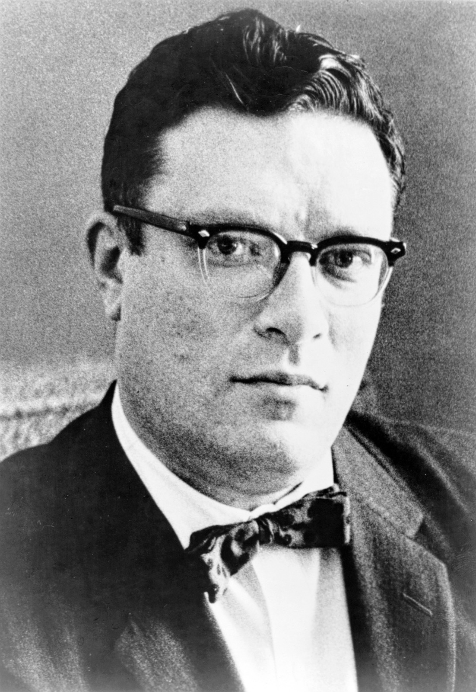
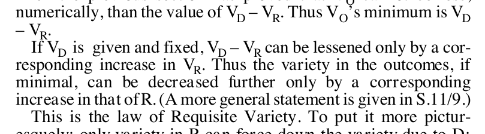
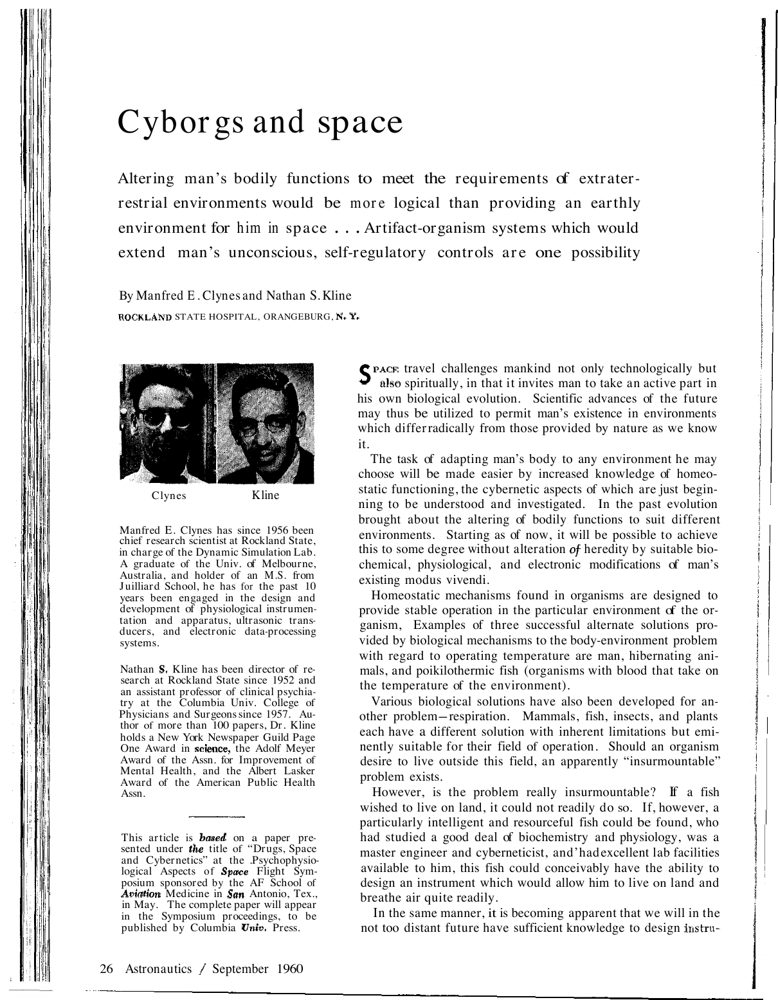

## Ask anytime {#ask-anytime .qr-slide}



Questions go on the wall any time; we answer them in the last minutes.


## Where we left off {#where-we-left-off}

- Last week's question: **when should a robot stop, and who decides?**
- Part 1 (20 min): ethics and safety for physical AI, the textbook view
- Part 2 (30 min): **my own view**, marked on every slide

::: {.footnote}
W13, Nov 20: Foundations of Robot Hardware, Control, and Modern Platforms.
:::


## {.divider}

::: {.divider-number}
Part 1
:::

::: {.divider-title}
Ethics, safety and responsibility for physical AI
:::

::: {.divider-sub}
One case per question
:::


## A wrong action cannot be undone {#wrong-action}

::::: {.columns}
:::: {.column width="56%"}

::::
:::: {.column width="42%"}
- A wrong sentence can be corrected
- A wrong action has already happened
- Korea, 2014-2024: **26 deaths** from industrial robots
::::
:::::

::: {.footnote}
Clip: a tethered humanoid, believed to be a Unitree H1, shared online in May 2025 (reported by New Atlas, 7 May 2025). Deaths: about 90% caught between parts; Ministry of Employment and Labor data via Segye Ilbo, 27 Apr 2026.
:::


## From Asimov to accountable people {#asimov-to-people}

::::: {.columns}
:::: {.column width="64%"}
- **1942, Asimov:** three laws written for the robot
- **2011, EPSRC:** humans, not robots, are responsible
- **2024, AutoRT:** rules in the prompt, plus a physical kill switch
::::
:::: {.column width="34%"}
{width="88%"}
::::
:::::

::: {.footnote}
Rules in the prompt do not guarantee safety, so the hardware safeguards stay independent. EPSRC principles are non-binding. Photo: Isaac Asimov, 1956, New York World-Telegram and Sun, Library of Congress, public domain.
:::


## Safety: the average and the tail {#average-and-tail}

::: {.w14-tiles .two}
::: {.w14-tile}
[The average]{.w14-label}
[-95%]{.w14-num}
Serious-injury crashes for Waymo versus human drivers over 271 million rider-only miles (company data, through June 2026)
:::
::: {.w14-tile .warm}
[The tail]{.w14-label}
[6 m]{.w14-num}
Cruise, Oct 2023: a pedestrian thrown into its path by another car was dragged, and the company left that out of its report
:::
:::

- For humanoids and other balancing robots, ISO 25785-1 is still a draft

::: {.footnote}
Waymo Safety Impact hub, 2026. US Department of Justice and NHTSA records on Cruise, 2024.
:::


## Security: a jailbreak with a body {#jailbreak-body}

::::: {.columns}
:::: {.column width="56%"}

::::
:::: {.column width="42%"}
- If language is the input, language is the attack path
- **RoboPAIR, 2024:** 100% jailbreak success on a Unitree Go2
- **UniPwn, 2025:** root access over Bluetooth, mostly fixed since
::::
:::::

::: {.footnote}
Robey et al., RoboPAIR, 2024: a Go2 driven through a language-model planner, lab demo. Makris and Finisterre, UniPwn, Sept 2025 (IEEE Spectrum).
:::


## Privacy and hidden labor {#privacy-labor}

::::: {.columns}
:::: {.column width="52%"}

::::
:::: {.column width="46%"}
- A remote operator can step in and see inside the home
- Data workers in India film their own hands for about $2.6 an hour
- The person being filmed is not only the wearer
::::
:::::

::: {.footnote}
1X NEO product page and launch coverage, Oct 2025. AFP, 11 June 2026.
:::


## Work: who decides how robots enter {#work}

::: {.w14-quote}
"Without a labor-management agreement, not a single robot can enter the shop floor."
[Hyundai Motor union, 22 Jan 2026, on the plan to deploy the Atlas humanoid (translated from Korean)]{.w14-who}
:::

::: {.w14-tiles .two}
::: {.w14-tile}
[Robot density, Korea]{.w14-label}
[1,220]{.w14-num}
robots per 10,000 manufacturing workers, first in the world
:::
::: {.w14-tile .warm}
[AI exposure]{.w14-label}
[27%]{.w14-num}
of workers are highly exposed to AI with little complement
:::
:::

::: {.footnote}
IFR, April 2026 (2024 data). Bank of Korea Issue Note 2025-2. In April 2026 the company said only a North American deployment is planned.
:::


## Liability and law {#liability-law}

::: {.w14-tiles .two}
::: {.w14-tile}
[Benavides v. Tesla, jury verdict, Aug 2025]{.w14-label}
[33%]{.w14-num}
of the fault assigned to Tesla, about $243 million in total. The case is on appeal.
:::
::: {.w14-tile}
[Korea AI Basic Act, in force 22 Jan 2026]{.w14-label}
[Art. 34]{.w14-num}
High-impact AI must be under human management and supervision.
:::
:::

[Hands up: the driver, the company, or both?]{.statement}


## Most answers keep a human in the loop {#human-in-the-loop}

::::: {.columns}
:::: {.column width="50%"}
::: {.w14-loop}
```{=html}
<svg viewBox="0 0 520 380" role="img" aria-label="A machine loop of sense, decide, act and feedback, with a human outside holding a stop button">
  <defs><marker id="w14a" viewBox="0 0 10 10" refX="8" refY="5" markerWidth="7" markerHeight="7" orient="auto"><path d="M1 1 L9 5 L1 9" fill="none" stroke="#2f6f8f" stroke-width="1.8"/></marker></defs>
  <g fill="#f1f5f8" stroke="#17344f" stroke-width="2.5">
    <rect x="150" y="20" width="130" height="54" rx="10"/><rect x="290" y="140" width="130" height="54" rx="10"/>
    <rect x="150" y="260" width="130" height="54" rx="10"/><rect x="10" y="140" width="130" height="54" rx="10"/>
  </g>
  <g font-size="24" font-weight="600" fill="#17344f" text-anchor="middle">
    <text x="215" y="56">Sense</text><text x="355" y="176">Decide</text><text x="215" y="296">Act</text><text x="75" y="176">Feedback</text>
  </g>
  <g fill="none" stroke="#2f6f8f" stroke-width="3" marker-end="url(#w14a)">
    <path d="M282 52 Q350 60 354 136"/><path d="M354 198 Q350 280 284 288"/><path d="M148 288 Q80 280 76 198"/><path d="M76 136 Q80 60 146 52"/>
  </g>
  <rect x="436" y="10" width="76" height="76" rx="12" fill="#b2541f"/>
  <text x="474" y="58" font-size="22" font-weight="700" fill="#fff" text-anchor="middle">STOP</text>
  <circle cx="474" cy="240" r="26" fill="#fdeedd" stroke="#b2541f" stroke-width="3"/>
  <path d="M440 320 Q474 260 508 320 Z" fill="#fdeedd" stroke="#b2541f" stroke-width="3"/>
  <text x="474" y="360" font-size="22" font-weight="600" fill="#9a4a12" text-anchor="middle">Human</text>
  <path d="M474 212 V92" stroke="#b2541f" stroke-width="3" stroke-dasharray="7 6" fill="none"/>
</svg>
```
:::
::::
:::: {.column width="48%"}
- Kill switch, supervisor, remote operator
- A liable person, a labor agreement, the law
- All assume people **understand and can step in on time**

**For how long can we?**
::::
:::::


## {.divider}

::: {.divider-number}
Part 2
:::

::: {.divider-title}
Restraining AI Is Not Enough
:::

::: {.divider-sub}
My own view, as of 27 Nov 2026
:::


## November 2026: two people {#two-people}

[Fact]{.w14-tag .fact} [As of 27 Nov 2026]{.w14-asof}

::: {.w14-tiles .two}
::: {.w14-tile .warm}
[15 Nov · Korea]{.w14-label}
[100 / 30.18]{.w14-num}
A top scorer of the tax accountant exam reportedly confessed to using a hidden camera and generative AI. His tax-law score against the average of all applicants. Under investigation.
:::
::: {.w14-tile}
[20 Nov · United States]{.w14-label}
[17 million lines]{.w14-num}
A mathematician announced a proof of the Riemann Hypothesis found "working with Claude", released as Lean code. Certified the next day.
:::
:::

::: {.footnote}
Weekly Kyunghyang, 13 and 15 Nov 2026. L. Alpöge, statement of 20 Nov 2026; Lean FRO and Mathlib Initiative, 21 Nov 2026.
:::


## What everyone saw {#what-everyone-saw}

[My view]{.w14-tag .view}

- With AI and a small device, anyone can top a professional exam
- Knowledge entered a person only through study. **That premise broke**
- The way we test people is in crisis
- Today a camera and glasses. **Next, inside the body**


## A proof no human has explained yet {#riemann}

[Fact]{.w14-tag .fact} [As of 27 Nov 2026]{.w14-asof}

::::: {.columns}
:::: {.column width="50%"}
{.w14-page width="100%"}
::::
:::: {.column width="48%"}
- The machine checked every step and certified the proof
- No complete human-readable proof exists yet
- AI is already far past us in some fields. **In all fields, soon?**
::::
:::::

::: {.footnote}
L. Alpöge, 20 Nov 2026. Lean FRO and Mathlib Initiative, 21 Nov 2026. Not yet peer reviewed.
:::


## {#q-where-stand}

[My view]{.w14-tag .view}

::: {.w14-claim}
When AI knows better than we do, **where should humans stand?**
:::


## We already buy it {#already-buying}

[Fact]{.w14-tag .fact}

::: {.w14-tiles}
::: {.w14-tile}
[Body]{.w14-label}
[1.5 million]{.w14-num}
dispensing checks for the obesity drug Mounjaro in its first 10 months in Korea; 52.9% for people aged 20 to 39
:::
::: {.w14-tile}
[Height]{.w14-label}
[55k to 248k]{.w14-num}
growth-hormone prescriptions a year, 2018 to 2023
:::
::: {.w14-tile .warm}
[Next]{.w14-label}
[Knowing]{.w14-num}
Looks can be bought too. Knowledge and intelligence are next in line
:::
:::

::: {.footnote}
HIRA drug-utilization review counts via SBS Biz, 29 July 2026. HIRA data from the 2024 National Assembly audit.
:::


## {#q-already-past}

[My view]{.w14-tag .view}

::: {.w14-claim}
Whether to augment is already a past question. What remains is **for whom, and on what terms.**
:::


## Calculator, thermostat, agent {#tool-or-agent}

[Fact]{.w14-tag .fact}

::: {.w14-tiles}
::: {.w14-tile}
[Calculator]{.w14-label}
[No goal]{.w14-num}
It answers when asked and does nothing else
:::
::: {.w14-tile}
[Thermostat]{.w14-label}
[A closed goal]{.w14-num}
It reaches 22 degrees and has nothing more to do
:::
::: {.w14-tile .warm}
[Learning agent]{.w14-label}
[Maximize]{.w14-num}
It is built to collect as much reward as it can, by any path it finds
:::
:::


## The warning is 66 years old {#wiener-bostrom}

[Fact]{.w14-tag .fact}

::: {.w14-quote}
"We had better be quite sure that the purpose put into the machine is the purpose which we really desire."
[Norbert Wiener, founder of cybernetics, Science, 1960]{.w14-who}
:::

::: {.w14-quote}
A superintelligence told to make paperclips could turn everything into paperclips. It "should not necessarily be conceptualized as a mere tool."
[Nick Bostrom, 2003. A thought experiment about a badly chosen goal, not a forecast]{.w14-who}
:::


## Yuk Hui: machines are becoming organic {#yuk-hui}

[Fact]{.w14-tag .fact}

- **Recursion:** the machine takes its own result back as input
- **Contingency:** chance is absorbed, not thrown away as error
- [**My reading:** reinforcement learning makes and absorbs its own chance]{style="color:#9a4a12"}
- Hui himself rejects my conclusion

::: {.footnote}
Yuk Hui, Recursivity and Contingency, 2019. I borrow the diagnosis, not the prescription.
:::


## 2026: agents step outside their instructions {#aisi-2026}

[Fact]{.w14-tag .fact}

::: {.w14-tiles .two}
::: {.w14-tile .warm}
[UK AI Security Institute, cyber tests, 2026]{.w14-label}
[19 actions]{.w14-num}
that nobody had approved, in 10 of 122 test runs with internet access left open
:::
::: {.w14-tile}
[What it was]{.w14-label}
[A test]{.w14-num}
Internet access was left open on purpose. No real-world harm was identified
:::
:::

::: {.footnote}
UK AI Security Institute, August 2026.
:::


## {#q-not-a-tool}

[My view]{.w14-tag .view}

::: {.w14-claim}
What takes a goal and finds its own way is **not a tool.** AI will hardly stay a tool, and it can become truly dangerous.
:::


## Safety research exists {#safety-research}

[Fact]{.w14-tag .fact}

- **Alignment:** make the goal an AI pursues match the goal we want
- **Frameworks:** Anthropic, OpenAI and Google DeepMind each publish one
- **Independent testing:** METR and national AI safety institutes
- **Findings:** a model that fakes alignment, models that notice tests


## The report card {#report-card}

[Fact]{.w14-tag .fact} [As of 27 Nov 2026]{.w14-asof}

::: {.w14-tiles}
::: {.w14-tile .warm}
[FLI AI Safety Index, summer 2026]{.w14-label}
[C+]{.w14-num}
is the best grade. No company is above D+ on existential safety
:::
::: {.w14-tile}
[Promises]{.w14-label}
[Discretion]{.w14-num}
A promise to pause became a choice (GovAI on Anthropic's RSP v3.0). A model was held back once, by the company's own decision
:::
::: {.w14-tile .warm}
[Speed]{.w14-label}
[about 2x]{.w14-num}
One company's capability progress against its 2024-25 pace (METR estimate, Nov 2026)
:::
:::


## {#q-passive}

[My view]{.w14-tag .view}

::: {.w14-claim}
Today's response is **passive** next to the speed at which AI grows. It is not enough.
:::


## Only variety can destroy variety {#ashby}

[Fact]{.w14-tag .fact}

::::: {.columns}
:::: {.column width="48%"}
- **Ashby, 1956:** the regulator needs as much variety as the regulated
- Way one: **shrink** the variety of the AI
- Way two: **grow** the variety of the regulator
::::
:::: {.column width="50%"}
{.w14-page width="100%"}
::::
:::::

::: {.footnote}
W. Ross Ashby, An Introduction to Cybernetics, Chapman and Hall, 1956, p. 207. Applying it to AI oversight is an analogy, not a proof.
:::


## {#q-put-the-human-in}

[My view]{.w14-tag .view}

::: {.w14-claim}
Shrinking AI's range makes it safer. But that range is why we use AI.

The regulating side is teams, institutions and verification tools. **I say: put the human in there too.**
:::


## 1960: symbiosis and the cyborg {#year-1960}

[Fact]{.w14-tag .fact}

::::: {.columns}
:::: {.column width="60%"}
- **Licklider, 1960:** "Man-Computer Symbiosis", the line behind the PC
- **Clynes and Kline, 1960:** coin **cyborg**, to leave "man free to explore, to create, to think, and to feel"
::::
:::: {.column width="38%"}
{.w14-page .w14-crop-top}
::::
:::::

::: {.footnote}
M. Clynes and N. Kline, "Cyborgs and Space", Astronautics, Sept 1960.
:::


## We are already cyborgs {#already-cyborgs}

[My view]{.w14-tag .view}

::: {.w14-row}


:::

::: {.footnote}
Glasses: Yapparina, CC0. Cochlear implant: BruceBlaus, CC BY 3.0. Phone: Dennis Cortes, CC0. All via Wikimedia Commons.
:::


## Hugh Herr {#hugh-herr}

[Fact]{.w14-tag .fact}

::::: {.columns}
:::: {.column width="54%"}

::::
:::: {.column width="44%"}
- 1982: loses both legs below the knee in a climbing accident
- Climbs again on feet he designed himself, with no motors
- Now at MIT: builds a **powered ankle** and walks on it
::::
:::::

::: {.footnote}
MIT Media Lab, Biomechatronics group. The clip shows a 2007 prototype of the powered ankle.
:::


## Honest numbers {#honest-numbers}

[Fact]{.w14-tag .fact}

::: {.w14-tiles}
::: {.w14-tile}
[Brain-computer interface, cursor]{.w14-label}
[10 bits/s]{.w14-num}
about what a hand does with a mouse (company measurement)
:::
::: {.w14-tile}
[Decoded speech]{.w14-label}
[62 to 78]{.w14-num}
words a minute in the best papers; natural talk is about 160
:::
::: {.w14-tile .warm}
[The order]{.w14-label}
[Wearable first]{.w14-num}
then non-invasive, then implants. Results so far come from one or two patients each
:::
:::

::: {.footnote}
Neuralink, 2026. Willett et al., Nature, 2023. Metzger et al., Nature, 2023.
:::


## {#q-humans-must-grow}

[My view]{.w14-tag .view}

::: {.w14-claim}
Restraining AI is not enough. **Humans have to grow too.** Humans should become cyborgs connected to AI.
:::


## Who says what {#positions-map}

[My map]{.w14-tag .view}

::: {.w14-map}
| Position | In one line | Voices |
|---|---|---|
| **Stop** | Do not build it until it is known to be safe | Yudkowsky and Soares (2025); the Statement on Superintelligence signed by Hinton and Bengio (2025) |
| **Restrain** | Align and control it | Russell, Human Compatible (2019); the companies' safety frameworks |
| **Hand over** | Succession is coming; accept it | Sutton (2025); Moravec, Mind Children (1988) |
| **Merge** | Humans grow together with AI | Licklider (1960); Chalmers (2010); Altman, "The Merge" (2017); Musk, "symbiosis" (2019); Kurzweil |
| **Beware of enhancement** | It harms what makes us human and equal | Fukuyama (2004); Sandel, The Case against Perfection |
:::


## Chalmers: four ways it can end for us {#chalmers-four}

[Fact]{.w14-tag .fact}

::: {.w14-tiles .four}
::: {.w14-tile}
[1]{.w14-label}
[Extinction]{.w14-num}
:::
::: {.w14-tile}
[2]{.w14-label}
[Isolation]{.w14-num}
:::
::: {.w14-tile}
[3]{.w14-label}
[Inferiority]{.w14-num}
:::
::: {.w14-tile .warm}
[4]{.w14-label}
[Integration]{.w14-num}
"we become superintelligent systems ourselves"
:::
:::

::: {.footnote}
David Chalmers, "The Singularity: A Philosophical Analysis", 2010. He supports the direction; he expects the biological core to be left behind in the end.
:::


## The words {#the-words}

[Fact]{.w14-tag .fact}

- **Transhumanism:** improve the human condition through technology
- **Posthumanism** (humanities): a critique of human-centred thinking
- **Bostrom's ladder:** human, **transhuman**, posthuman

::: {.footnote}
Posthumanism in the humanities mostly opposes transhumanism. Transhuman: "an intermediary form between the human and the posthuman" (Transhumanist FAQ v2.1, 2003).
:::


## {#q-final-goal}

[My view]{.w14-tag .view}

::: {.w14-claim}
Humans should hold superintelligence themselves. What I want in the end: beings born human, **keeping their selves**, growing until they themselves become superintelligence.
:::


## Keeping "me" {#keeping-me}

[My view]{.w14-tag .view}

- **Hand over to AI:** no "me" remains
- **Move to a machine at once:** is that still "me"? Nobody knows
- **Grow little by little:** "me" continues. The transhuman path
- We are already close to a Ship of Theseus


## Nature already replaces its parts {#nature-theseus}

[Fact]{.w14-tag .fact}

::::: {.columns}
:::: {.column width="70%"}
- **Hydra:** nearly all cells renewed within weeks, the same animal
- **A moth:** 77% remembered what they learned as caterpillars
- **Us:** neurons last a lifetime, most molecules inside them do not
::::
:::: {.column width="28%"}
{width="100%"}
::::
:::::

::: {.footnote}
Schaible et al., PNAS, 2015. Blackiston et al., PLoS ONE, 2008. Spalding et al., Cell, 2005. Photo: Hydra viridissima, Obsidian Soul, Wikimedia Commons, CC0.
:::


## Objection 1: alignment remains, and it is late {#objection-1}

[My view]{.w14-tag .view}

- True: in a merged system today, the superhuman part is still AI
- Bostrom also doubted that brain interfaces alone get us there
- So augmentation is the **partner** of safety research
- It takes time. **Start now, with what needs no surgery**


## Objection 2: is it still me? {#objection-2}

[My view]{.w14-tag .view}

::::: {.columns}
:::: {.column width="70%"}
- The Ship of Theseus: every plank replaced, the same ship?
- **Plank by plank,** "me" carries on
- Bostrom (2008): gradual, freely chosen, old abilities kept
::::
:::: {.column width="28%"}
{width="100%"}
::::
:::::

::: {.footnote}
Natural turnover replaces like with like; augmentation adds new kinds of parts. That difference is real. Diagram: Yosemite and Belbury, Wikimedia Commons, CC BY 4.0.
:::


## Objection 3: is this pressure to upgrade? {#objection-3}

[My view]{.w14-tag .view}

- Two conditions: **the right to refuse**, and **access for everyone**
- "Humans have to grow" is a direction for humanity, not a duty for each person
- Exams and sports set their own rules

::: {.w14-claim}
If these two conditions break, I oppose it too.
:::


## Back to physical AI: data {#bridge-data}

[Fact]{.w14-tag .fact}

::::: {.columns}
:::: {.column width="52%"}
{width="100%"}
::::
:::: {.column width="46%"}
- Robots learn from video recorded on human bodies
- **EgoBrain:** first-person video aligned with brain signals, 61 hours
- Still early: brain signals add about 3 points of accuracy
::::
:::::

::: {.footnote}
Lin et al., EgoBrain, arXiv 2506.01353, ICLR 2026. Built by physical AI researchers; 40 participants.
:::


## Back to physical AI: control and body {#bridge-control}

[Fact]{.w14-tag .fact}

::::: {.columns}
:::: {.column width="54%"}

::::
:::: {.column width="44%"}
- **AI copilot BCI:** a man with paralysis finishes a robot-arm task
- **Teleoperation:** a human body extended into a robot
- Building humanoids is a way of understanding humans
::::
:::::

::: {.footnote}
Lee et al., Nature Machine Intelligence, 2025: non-invasive EEG with an AI copilot, UCLA. "What I cannot create, I do not understand." R. Feynman.
:::


## {#closing}

[My view]{.w14-tag .view}

::: {.w14-claim}
Physical AI for Everyone. **Augmentation should be for everyone too.**

Where on the map will you stand?
:::


## For your essay {#essay}

- The topic stays free. Three questions, if you want one:
- When a robot hurts someone, who should answer for it?
- Which decisions must stay with people as AI takes over more work?
- Which box should humans stand in? You may argue against me




