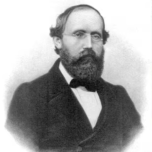
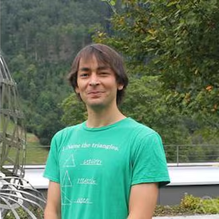
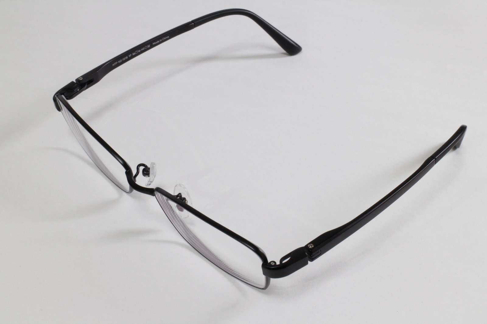
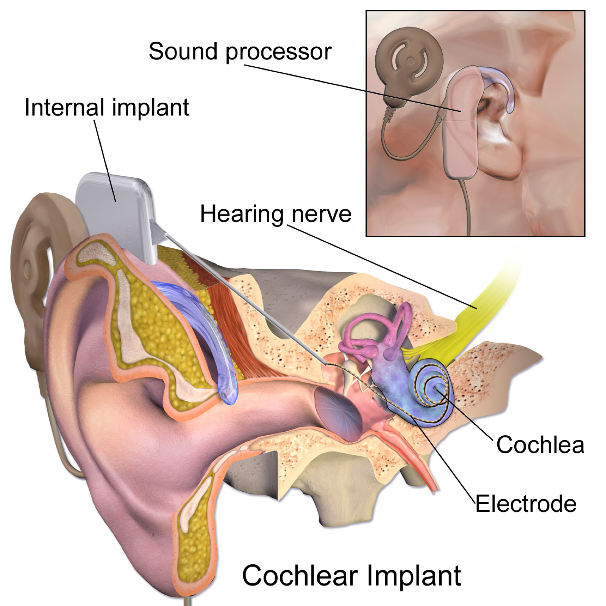
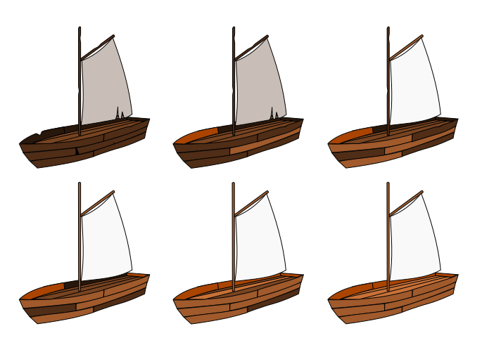

## Ask anytime {#ask-anytime .qr-slide}



Questions go on the wall any time; we answer them in the last minutes.


## Where we left off {#where-we-left-off}

[When should a robot stop, and who decides?]{.statement}

Part 1 · **Safety and social responsibility** of physical AI\
Part 2 · **Ethics and philosophy** for the age of AI

::: {.footnote}
W13, Nov 20: Foundations of Robot Hardware, Control, and Modern Platforms.
:::


## {.divider}

::: {.divider-number}
Part 1
:::

::: {.divider-title}
Safety and social responsibility of physical AI
:::

::: {.divider-sub}
One case per question
:::


## A wrong action cannot be undone {#wrong-action}



[Korea, 2014 to 2024: **26 deaths** from industrial robots.]{.fragment}

::: {.footnote}
New Atlas, May 2025 · Ministry of Employment and Labor, via Segye Ilbo, Apr 2026
:::


## From Asimov to accountable people {#asimov-to-people}



[A rule in the prompt is no guarantee. **The hardware stop stays.**]{.fragment}

::: {.footnote}
EPSRC Principles of Robotics, 2011 · Ahn et al., AutoRT, 2024
:::


## Safety: the average and the tail {#average-and-tail}



[For robots that balance, **ISO 25785-1 is still a draft.**]{.fragment}

::: {.footnote}
Waymo Safety Impact, company data to June 2026 · US DOJ and NHTSA on Cruise, 2024
:::


## Security: a jailbreak with a body {#jailbreak-body}



If language is the input, **language is the attack path.**

::: {.footnote}
Robey et al., RoboPAIR, 2024, lab demo
:::


## Privacy: a camera inside the home {#privacy-home}



When the robot gets stuck, **a remote operator sees your home.**

::: {.footnote}
1X NEO, Oct 2025
:::


## Hidden labor: who films the training data {#hidden-labor}



India, 2026: about **$2.60** for an hour of video like this.

[The person being filmed is **not only the wearer.**]{.fragment}

::: {.footnote}
AFP, June 2026 · Clip: EgoScale, NVIDIA GEAR Lab, 2026
:::


## Work: who decides how robots enter {#work}

["Without a labor-management agreement, not a single robot can enter the shop floor."]{.statement}

[Hyundai Motor union, January 2026 (translated)]{.w14-who}


## Why this matters most in Korea {#work-numbers}



[**27%** of workers: high AI exposure, low complement.]{.fragment}

::: {.footnote}
IFR, 2026 (2024 data) · Bank of Korea, 2025
:::


## Liability: who answers for the crash? {#liability-law}

Florida, 2019: a Tesla on Autopilot hits a parked car.

[Hands up: the driver, the company, or both?]{.statement}

::: {.fragment}

:::

::: {.footnote}
Benavides v. Tesla, 2025
:::


## The law is moving too {#ai-basic-act}

[Korea AI Basic Act, Article 34]{.w14-who}

[High-impact AI stays under\
**human management and supervision.**]{.statement}

::: {.footnote}
In force since 22 Jan 2026 · fines deferred during a grace period
:::


## Most answers keep a human in the loop {#human-in-the-loop}



Every answer assumes a person who can **step in on time.**

[For how long can we?]{.fragment .w14-ask}


## {.divider}

::: {.divider-number}
Part 2
:::

::: {.divider-title}
Restraining AI Is Not Enough
:::

::: {.divider-sub}
Ethics and philosophy for the age of AI
:::


## November 2026: two people {#two-people}

[As of 27 Nov 2026]{.w14-asof}

```{=html}
<div class="w14-events">
<figure><figcaption>Tax exam · 15 Nov</figcaption></figure>
<figure class="fragment"><div class="w14-twin"></div><figcaption>Riemann Hypothesis proof · 20 Nov</figcaption></figure>
</div>
```

::: {.footnote}
[Kyunghyang, 18 Nov](https://www.khan.co.kr/article/202611180600061), case under investigation · [Chosun, 21 Nov](https://www.chosun.com/economy/science/2026/11/21/EIBR47HSIBBSDBGW73KPAKA554/) · Riemann: Wikimedia · Alpöge: MFO
:::


## What everyone saw {#what-everyone-saw}



[Today a camera and glasses. **Next, inside the body.**]{.fragment}


## A proof no human has explained yet {#riemann}

[As of 27 Nov 2026]{.w14-asof}



[AI is far past us in some fields. **In all fields, soon?**]{.fragment}

::: {.footnote}
L. Alpöge, Nov 2026 · Lean FRO and Mathlib Initiative · not yet peer reviewed
:::


## {#q-where-stand}

[When AI knows better than we do,\
**where should humans stand?**]{.statement .w14-big}


## We already buy it {#already-buying}



::: {.footnote}
HIRA data via SBS Biz, July 2026 · National Assembly audit, 2024
:::


## {#q-already-past}

Whether to augment is already a past question.

[What remains is\
**for whom, and on what terms.**]{.statement .w14-big .fragment}


## Calculator, thermostat, agent {#tool-or-agent}




## The warning is 66 years old {#wiener-bostrom}

["We had better be quite sure that the purpose put into the machine is the purpose which we really desire."]{.statement}

[Norbert Wiener, Science, 1960]{.w14-who}


## The paperclip maximizer {#paperclip}



["should not necessarily be conceptualized as a mere tool"]{.statement}

[Nick Bostrom, 2003: a thought experiment, not a forecast]{.w14-who}


## Yuk Hui: machines are becoming organic {#yuk-hui}



[**My reading:** reinforcement learning makes and absorbs its own chance.]{.fragment}

::: {.footnote}
Yuk Hui, Recursivity and Contingency, 2019 · Hui himself criticizes transhumanism
:::


## 2026: agents step outside their instructions {#aisi-2026}



[A test, with internet access left open. **No real-world harm.**]{.fragment}

::: {.footnote}
UK AI Security Institute, August 2026
:::


## {#q-not-a-tool}

[My view]{.w14-tag .view}

[What takes a goal and finds its own way\
**is not a tool.**]{.statement .w14-big}

[AI will hardly stay a tool, and it can become truly dangerous.]{.fragment}


## Safety research exists {#safety-research}

**Alignment** · make the AI's goal match ours

**Frameworks** · each frontier lab publishes one

**Independent tests** · METR, AI safety institutes

**Findings** · models that fake alignment


## The report card {#report-card}

[As of 27 Nov 2026]{.w14-asof}




## Promises and speed {#promises-speed}

[As of 27 Nov 2026]{.w14-asof}

A promise to pause became **the company's own choice.**

[Capability is moving at **about 2x** its 2024-25 pace.]{.fragment}

::: {.footnote}
GovAI on Anthropic's RSP v3.0 · METR estimate for one company, Nov 2026
:::


## {#q-passive}

[My view]{.w14-tag .view}

[Next to the speed at which AI grows,\
today's response is **passive.**]{.statement .w14-big}

[It is not enough.]{.fragment}


## Only variety can destroy variety {#ashby}



**Ashby, 1956:** a regulator needs as much variety as what it regulates.

::: {.footnote}
W. Ross Ashby, An Introduction to Cybernetics, 1956 · applied to AI as an analogy
:::


## {#q-put-the-human-in}

The regulator is teams, institutions and verification tools.

[I say: **put the human in there too.**]{.statement .w14-big .fragment}


## 1960: symbiosis and the cyborg {#year-1960}



["to leave man free to explore, to create, to think, and to feel"]{.fragment}

::: {.footnote}
Licklider, "Man-Computer Symbiosis", 1960 · Clynes and Kline, "Cyborgs and Space", 1960
:::


## We are already cyborgs {#already-cyborgs}

```{=html}
<div class="w14-row">
<figure><figcaption>Glasses</figcaption></figure>
<figure class="fragment"><figcaption>Cochlear implant</figcaption></figure>
<figure class="fragment"><figcaption>Your phone</figcaption></figure>
</div>
```

::: {.footnote}
Glasses: Yapparina, CC0 · Cochlear implant: BruceBlaus, CC BY 3.0 · Phone: Dennis Cortes, CC0 · Wikimedia Commons
:::


## Hugh Herr {#hugh-herr}



He lost both legs in 1982. **Now he builds the ankle he walks on.**

::: {.footnote}
MIT Media Lab · the clip shows a 2007 prototype
:::


## Honest numbers {#honest-numbers}



[So the order is **wearable first**, then non-invasive, then implants.]{.fragment}

::: {.footnote}
Card et al., Nature Medicine, 2026, one patient · lab peaks of 62 to 78 in 2023 (Willett; Metzger)
:::


## {#q-humans-must-grow}

[My view]{.w14-tag .view}

Restraining AI is not enough.

[Humans have to grow too.]{.statement .w14-thesis .fragment}

[Humans should become cyborgs connected to AI.]{.fragment}


## Who says what {#pos-stop .top-align .w14-pos}

```{=html}
<div class="w14-strip"><span class="on">Stop</span><span>Restrain</span><span>Hand over</span><span>Merge</span><span>Beware</span></div>
```

[Do not build it\
until it is known to be safe.]{.statement .w14-big}

[Yudkowsky and Soares · Hinton and Bengio]{.w14-who}


## Who says what {#pos-restrain .top-align .w14-pos}

```{=html}
<div class="w14-strip"><span>Stop</span><span class="on">Restrain</span><span>Hand over</span><span>Merge</span><span>Beware</span></div>
```

[Align it and control it.]{.statement .w14-big}

[Russell · the AI companies' safety frameworks]{.w14-who}


## Who says what {#pos-hand-over .top-align .w14-pos}

```{=html}
<div class="w14-strip"><span>Stop</span><span>Restrain</span><span class="on">Hand over</span><span>Merge</span><span>Beware</span></div>
```

[Succession is coming.\
Accept it.]{.statement .w14-big}

[Sutton · Moravec]{.w14-who}


## Who says what {#pos-merge .top-align .w14-pos}

```{=html}
<div class="w14-strip"><span>Stop</span><span>Restrain</span><span>Hand over</span><span class="on">Merge</span><span>Beware</span></div>
```

[Humans grow\
together with AI.]{.statement .w14-big}

[Licklider · Chalmers · Altman · Musk · Kurzweil]{.w14-who}


## Who says what {#pos-beware .top-align .w14-pos}

```{=html}
<div class="w14-strip"><span>Stop</span><span>Restrain</span><span>Hand over</span><span>Merge</span><span class="on">Beware</span></div>
```

[Enhancement harms\
what makes us human and equal.]{.statement .w14-big}

[Fukuyama · Sandel]{.w14-who}


## Who says what {#positions-map .top-align .w14-pos}

```{=html}
<div class="w14-strip w14-all"><span>Stop</span><span class="on">Restrain</span><span>Hand over</span><span class="on">Merge</span><span>Beware</span></div>
```

I stand in **Restrain** and **Merge** together.


## Chalmers: four ways it can end for us {#chalmers-four}



["we become superintelligent systems ourselves"]{.fragment}

::: {.footnote}
David Chalmers, "The Singularity: A Philosophical Analysis", 2010
:::


## The words {#the-words}

**Transhumanism** · improve the human condition through technology

**Posthumanism** · a critique of human-centred thinking

::: {.fragment}

:::

::: {.footnote}
Transhumanist FAQ v2.1, 2003 · posthumanism as used in the humanities
:::


## {#q-final-goal}

[My view]{.w14-tag .view}

Humans should hold superintelligence themselves.

[Beings born human, **keeping their selves**,\
growing until they themselves\
become superintelligence.]{.statement .w14-big .fragment}


## Keeping "me" {#keeping-me}



[We are already close to a **Ship of Theseus.**]{.fragment}


## Nature already replaces its parts {#nature-theseus}

:::: {.w14-pair}


::: {.w14-facts}
**Hydra** nearly every cell renewed in weeks

[**A moth** remembers what the caterpillar learned]{.fragment}

[**Us** neurons stay, their molecules do not]{.fragment}
:::
::::

::: {.footnote}
Schaible 2015 · Blackiston 2008 · Spalding 2005 · Photo: Hydra viridissima, Obsidian Soul, Wikimedia Commons, CC0
:::


## Objection 1 {#objection-1}

["Even if we merge, the alignment problem remains. And it is too late."]{.statement .w14-objection}


## Objection 1: my answer {#answer-1}

[True. So augmentation is\
the **partner** of safety research.]{.statement .w14-big}

[It takes time. **Start now, with what needs no surgery.**]{.fragment}


## Objection 2 {#objection-2}

["After all those changes, is it still me?"]{.statement .w14-objection}


## Objection 2: my answer {#answer-2}

::: {.w14-photo .w14-small}

:::

[**Plank by plank**, "me" carries on.]{.statement .w14-big}

[Bostrom, 2008: gradual, freely chosen, old abilities kept.]{.fragment}

::: {.footnote}
Diagram: Yosemite and Belbury, Wikimedia Commons, CC BY 4.0
:::


## Objection 3 {#objection-3}

["If others grow and I refuse, I fall behind. So it is forced on me."]{.statement .w14-objection}


## Objection 3: my answer {#answer-3}

Two conditions.

[The right to refuse.]{.statement .w14-big .fragment}

[Access for everyone.]{.statement .w14-big .fragment}

[If these two break, I oppose it too.]{.fragment .w14-ask}


## Back to physical AI: data {#bridge-data}

::: {.w14-photo}

:::

**EgoBrain:** first-person video aligned with brain signals.

::: {.footnote}
Lin et al., EgoBrain, arXiv 2506.01353, ICLR 2026
:::


## Back to physical AI: control and body {#bridge-control}



Building humanoids is a way of **understanding humans.**

::: {.footnote}
Lee et al., Nature Machine Intelligence, 2025
:::


## {#closing}

Physical AI for Everyone.

[Augmentation should be\
for everyone too.]{.statement .w14-thesis .fragment}

[Where on the map will you stand?]{.fragment}


## For your essay {#essay}

The topic stays free. Three questions, if you want one.

1. When a robot hurts someone, who should answer for it?
2. Which decisions must stay with people?
3. Where should humans stand? You may argue against me.




